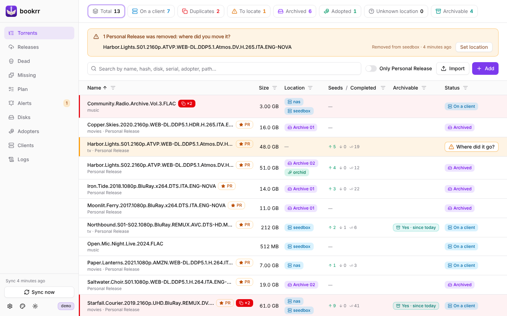
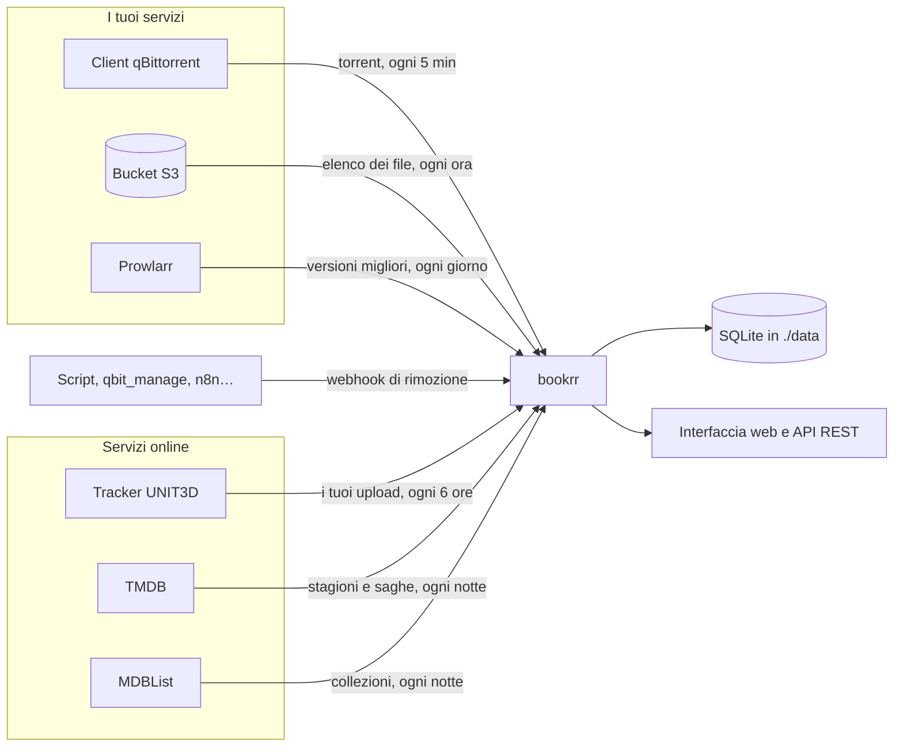
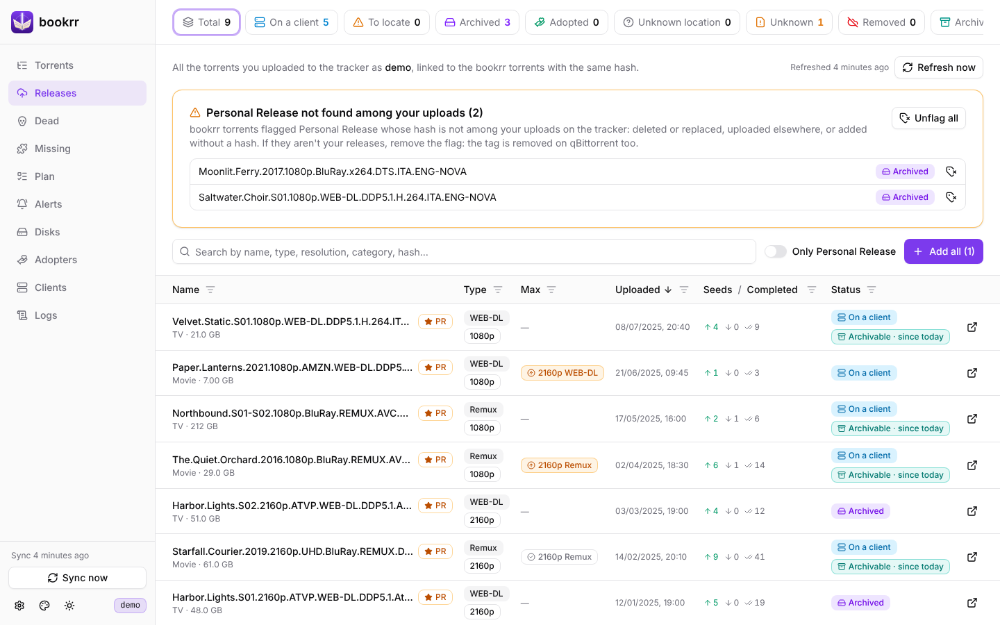
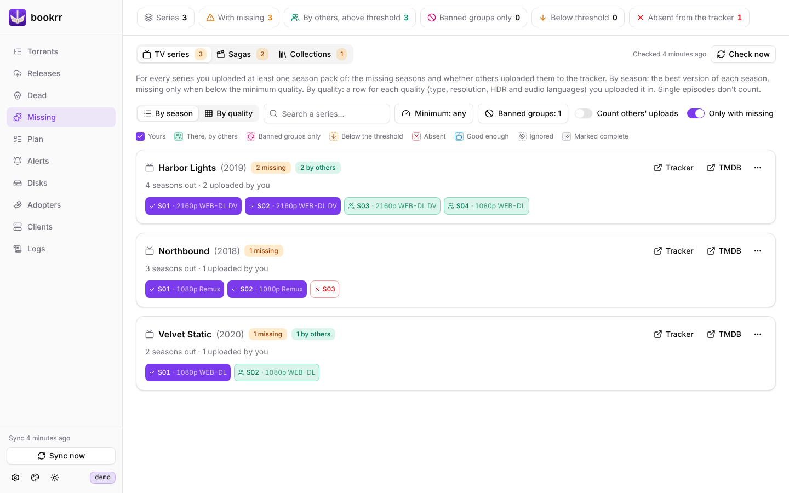
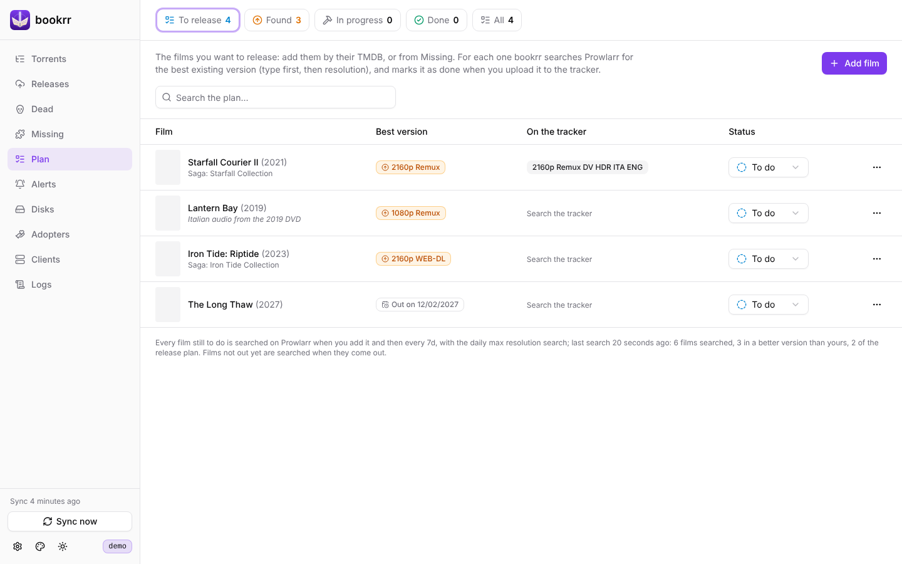
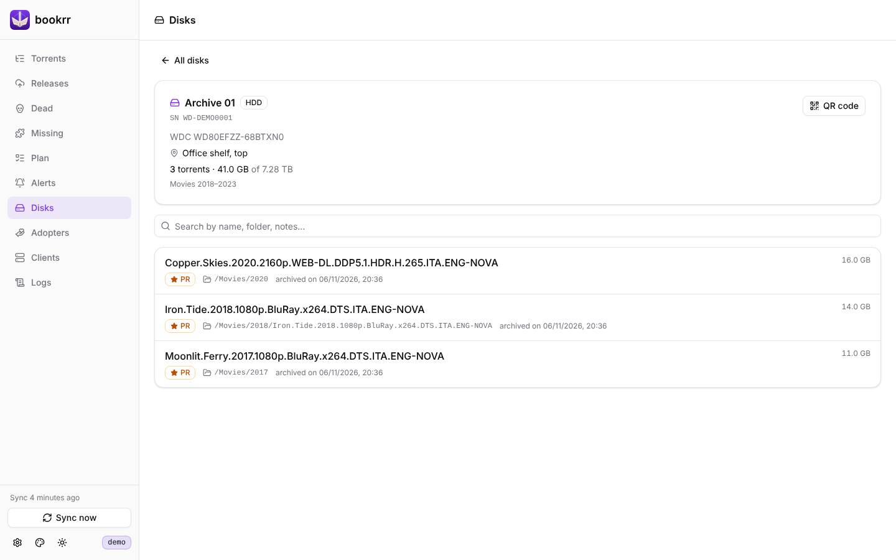
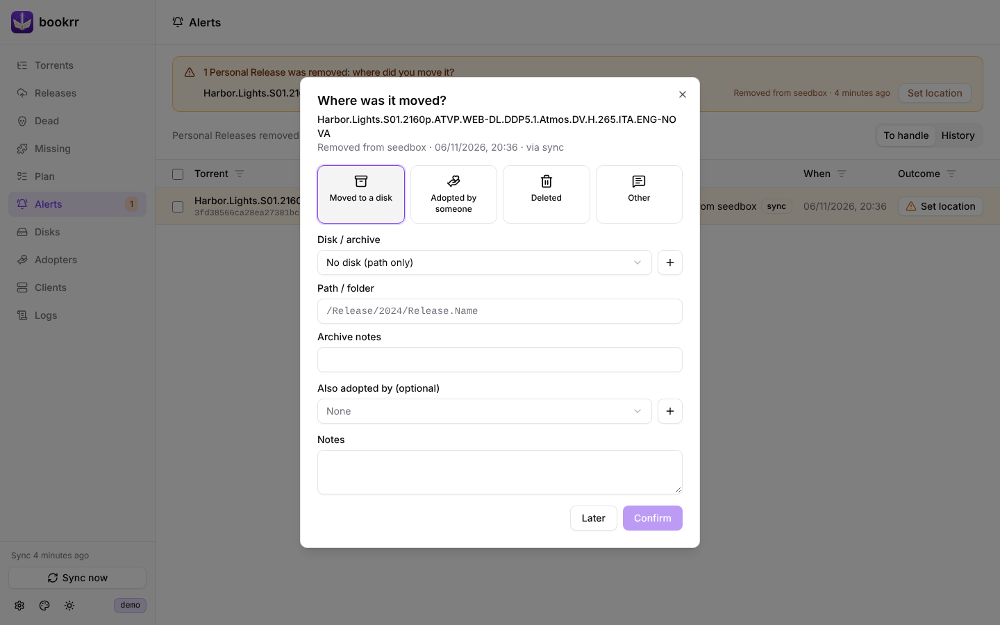
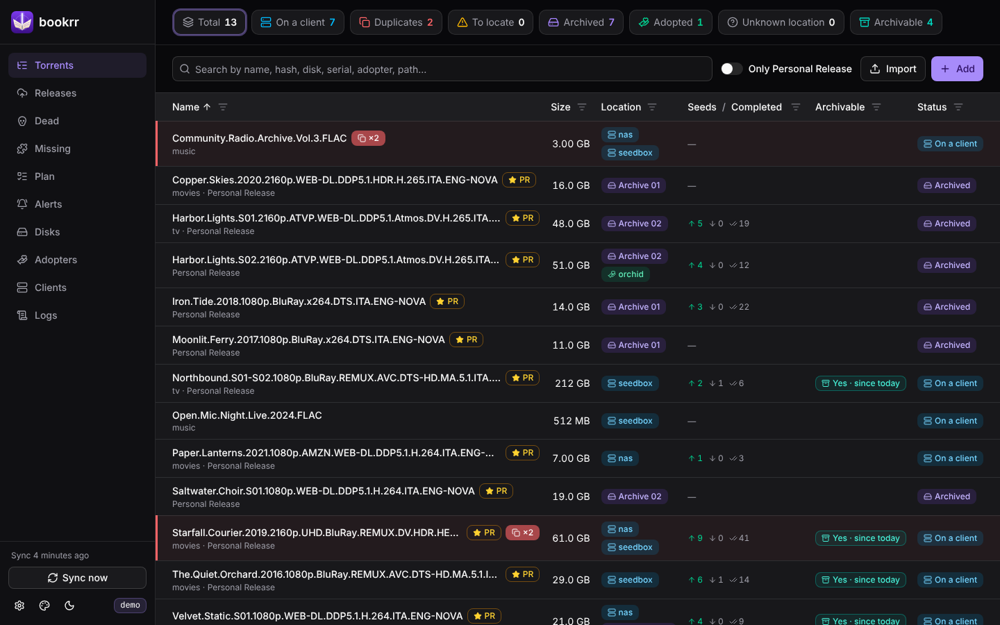

<p align="center"></p>

<h1 align="center">bookrr</h1>

> [!IMPORTANT]
> **Full Vibe Coded.** Ogni riga di bookrr, il codice, i test e questa documentazione, è stata scritta da un assistente di programmazione basato su IA, sotto la guida del proprietario. È usato ogni giorno ed è coperto da test, ma leggi il codice prima di affidargli i tuoi dati e tieni una copia di `./data`.

<p align="center"><a href="README.md">English</a> · <b>Italiano</b> · <a href="docs/it/README.md">Documentazione</a></p>

L'inventario dei tuoi torrent: **dove sono** (su quale client qBittorrent, su quale disco d'archivio, chi li ha adottati) e **cosa è sparito** dai client. Per chi carica su un tracker UNIT3D tiene anche lo **storico delle tue release**, trova le **stagioni e i film che ti mancano** e la **versione migliore** di ogni film, e ti dice quali release puoi **archiviare**.

> L'interfaccia è in inglese: in questa documentazione i nomi di pagine, pulsanti e filtri sono scritti come li vedi (es. **Missing**, **Settings**).



## Funzioni

- 📋 **Un solo elenco** di tutti i torrent di uno o più client qBittorrent, con ricerca e **filtri su ogni colonna**.
- 🧬 **Duplicati**: lo stesso torrent su più client, dove è ancora in download, e la rimozione da un client (con o senza i file) da bookrr.
- 🔔 **Release rimosse**: quando un torrent con il tag `Personal Release` sparisce da tutti i client, bookrr ti chiede **dove l'hai spostato** (disco, adottatore, eliminato, altro). Anche via webhook.
- 💽 **Archivi offline**: dischi con numero di serie, modello, capacità e posizione, **dati SMART** incollati da `smartctl` o CrystalDiskInfo e un **QR code** da attaccare a ogni disco che apre l'elenco dei suoi torrent.
- ☁️ **Archivi su cloud S3** (Scaleway e servizi compatibili), in **sola lettura**: bookrr riconosce da solo cosa hai spostato nel bucket.
- 🤝 **Adottatori**: le persone che hanno adottato le tue release e continuano a condividerle.
- 📥 **Import da CSV/Excel** dei torrent già archiviati.
- 🚀 **Storico release** dal tracker UNIT3D (anche gli upload anonimi) con seeder e completati, collegato ai torrent di bookrr; l'**hash** dei torrent aggiunti senza viene cercato sul tracker.
- 🧩 **Stagioni e film mancanti**: per le tue serie, per le **saghe** dei tuoi film (TMDB) e per le **collezioni** che segui (MDBList), cosa manca nella tua qualità, con qualità minima, gruppi bannati e le tue scelte.
- 📺 **Risoluzione massima**: con Prowlarr, i film che esistono in una versione migliore della tua.
- 📝 **Piano release**: i film che vuoi rilasciare, con la versione migliore che esiste, segnati come fatti quando li carichi.
- 📦 **Release archiviabili**: le tue release ancora su un client che altri stanno già seminando.
- 📜 Pagina dei **log**, con un file al giorno conservato nella cartella dati.
- 🌗 Tema chiaro e scuro e sei **colori di spada laser** per il logo e i pulsanti.
- 🐳 Un solo container di circa 9 MB, per **amd64, 386, arm64, armv7 e armv6** (Raspberry Pi compreso).

## Come si collega



Servono solo i client qBittorrent: ogni altro servizio è facoltativo e attiva le sue pagine.

## Screenshot

| | |
|---|---|
|  **Releases**: i tuoi upload sul tracker, con la versione migliore che esiste (Max) |  **Missing**: la versione migliore di ogni stagione rispetto alla tua qualità minima |
|  **Plan**: i film da rilasciare e cosa ha trovato Prowlarr |  **Pagina del disco**: i torrent su un disco, aperta dal suo QR code |
|  **Alerts**: dove è finita la release rimossa? |  **Tema scuro** |

Altri nella [documentazione](docs/it/README.md).

## Installazione

### Docker Compose (consigliato)

```bash
mkdir bookrr && cd bookrr
curl -O https://raw.githubusercontent.com/TehMaat/bookrr/main/docker-compose.yml
docker compose up -d
```

Apri `http://IP-DEL-SERVER:8080`, vai su **Clients** e aggiungi i tuoi qBittorrent (indirizzo della Web UI, utente e password). Tracker, TMDB, MDBList e Prowlarr si collegano da **Settings** (⚙️ in basso a sinistra). Tutto viene salvato in `./data`.

### Docker run

```bash
docker run -d --name bookrr --restart unless-stopped \
  -p 8080:8080 -v "$PWD/data:/data" -e TZ=Europe/Rome \
  ghcr.io/tehmaat/bookrr:latest
```

### Tag dell'immagine e aggiornamenti

L'immagine `ghcr.io/tehmaat/bookrr` è multi-architettura: Docker scarica quella giusta per la tua macchina. La versione in uso è mostrata in fondo al menu a sinistra.

| Tag | Segue |
|---|---|
| `latest` | ogni versione pubblicata da `main` |
| `0.24` | solo le correzioni della 0.24 |
| `0.24.0` | esattamente quella versione |

Per aggiornare: `docker compose pull && docker compose up -d`. Il database viene migrato da solo all'avvio; fai prima una copia di `./data`.

### Compilare l'immagine

```bash
git clone https://github.com/TehMaat/bookrr.git && cd bookrr
docker compose up -d --build
```

> La compilazione locale richiede un'immagine `node` per la tua piattaforma: su macchine x86 a 32 bit usa l'immagine pubblicata oppure compila da un'altra macchina con `docker buildx build --platform linux/386`.

### Senza Docker

Con Go 1.24+ e Node 22+ ottieni un unico eseguibile con l'interfaccia dentro:

```bash
git clone https://github.com/TehMaat/bookrr.git && cd bookrr
cd web && npm ci && npm run build && cd ..
go build -o bookrr ./cmd/bookrr
BOOKRR_DATA_DIR=./data ./bookrr
```

## Configurazione

Quasi tutte le opzioni si impostano da **Settings** nell'interfaccia e si applicano subito, senza riavviare; ogni scheda ha un pulsante **Test** per verificare indirizzo e chiave prima di salvare. Un'opzione impostata come variabile d'ambiente (vedi [`docker-compose.yml`](docker-compose.yml)) **ha la precedenza**: in Settings compare bloccata. Indirizzo, cartella dati, login e token del webhook sono solo variabili d'ambiente.

| Variabile | Default | Descrizione |
|---|---|---|
| `BOOKRR_SYNC_INTERVAL` | `5m` | Ogni quanto leggere i client (minimo `30s`). |
| `BOOKRR_RELEASE_TAG` | `Personal Release` | Il tag qBittorrent che identifica le tue release (maiuscole/minuscole indifferenti). |
| `BOOKRR_S3_SCAN_INTERVAL` | `1h` | Ogni quanto leggere i bucket S3 degli archivi cloud (minimo `1m`). |
| `BOOKRR_UNIT3D_URL` / `BOOKRR_UNIT3D_API_KEY` | — | Indirizzo del tracker UNIT3D (es. `https://tracker.example`) e la tua API key: ricerca degli hash e storico release. |
| `BOOKRR_UNIT3D_RELEASES_INTERVAL` | `6h` | Ogni quanto rileggere i tuoi upload (minimo `15m`). |
| `BOOKRR_TMDB_API_KEY` | — | Chiave API (v3) o token di lettura (v4) di [TMDB](https://www.themoviedb.org/settings/api): con il tracker, stagioni mancanti e film delle saghe; da sola basta per aggiungere film al piano. |
| `BOOKRR_MDBLIST_API_KEY` | — | Chiave API di [MDBList](https://mdblist.com) (gratuita, nelle preferenze del tuo account): con il tracker e TMDB, le collezioni. |
| `BOOKRR_MISSING_CHECK_AT` | `04:00` | Ora del controllo notturno dei mancanti (ora locale, vedi `TZ`). |
| `BOOKRR_PROWLARR_URL` / `BOOKRR_PROWLARR_API_KEY` | — | Indirizzo di [Prowlarr](https://prowlarr.com) (es. `http://prowlarr:9696`) e la sua API key (Settings → General): con il tracker, risoluzione massima e ricerche del piano. |
| `BOOKRR_PROWLARR_RECHECK` | `7d` | Ogni quanto cercare di nuovo ogni film (minimo `1d`; anche in ore, es. `36h`). |
| `BOOKRR_LOG_RETENTION` | `30d` | Per quanti giorni tenere i file di log (minimo `1d`, `0` = per sempre). |
| `BOOKRR_LOG_MAX_SIZE` | `50MB` | Dimensione massima di un file di log; oltre, il giorno prosegue in un file nuovo (minimo `1MB`, `0` = senza limite). |
| `BOOKRR_LOG_LEVEL` | `info` | Livello minimo scritto: `debug`, `info`, `warn` o `error`. |
| `BOOKRR_AUTH_USER` / `BOOKRR_AUTH_PASSWORD` | — | *Solo ambiente.* Se impostati, interfaccia e API chiedono il login (HTTP Basic). |
| `BOOKRR_WEBHOOK_TOKEN` | — | *Solo ambiente.* Se impostato, il webhook richiede il token (`?token=…`, header `X-Bookrr-Token` o `Authorization: Bearer …`). |
| `BOOKRR_LISTEN` | `:8080` | *Solo ambiente.* Indirizzo di ascolto. |
| `BOOKRR_DATA_DIR` | `/data` | *Solo ambiente.* Cartella del database e dei log. |
| `TZ` | — | Fuso orario dei log, del cambio di giorno e del controllo notturno (es. `Europe/Rome`). |

> [!WARNING]
> Le password dei client qBittorrent e le chiavi dei bucket S3 e dei servizi sono salvate in chiaro nel database in `./data`: proteggi quella cartella. Se bookrr è raggiungibile da fuori della tua rete, imposta un login e un token per il webhook.

## Documentazione

| Guida | |
|---|---|
| [Client, duplicati e segnalazioni](docs/it/client-e-segnalazioni.md) | sincronizzazione, release rimosse, spostamenti e adozioni, webhook di rimozione |
| [Archivi](docs/it/archivi.md) | dischi e QR code, dati SMART, bucket S3, import CSV |
| [Tracker](docs/it/tracker.md) | ricerca degli hash, storico release, release archiviabili |
| [Risoluzione massima e piano release](docs/it/prowlarr-e-piano.md) | ricerche con Prowlarr |
| [Stagioni e film mancanti](docs/it/mancanti.md) | serie, saghe, collezioni, qualità minima, gruppi bannati |
| [Log](docs/it/log.md) | file di log e pagina Logs |
| [API](docs/it/api.md) | l'API REST |
| [Sviluppo](docs/it/sviluppo.md) | compilazione, test, struttura del progetto, demo e screenshot |
