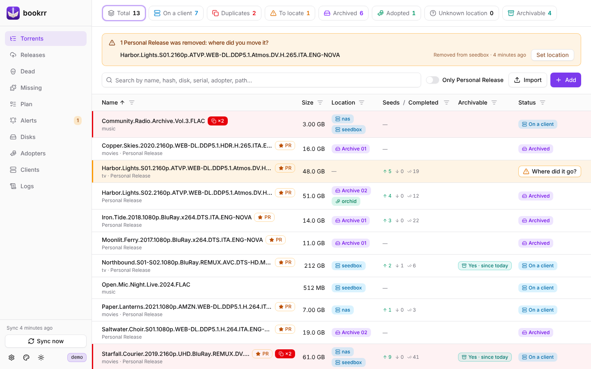
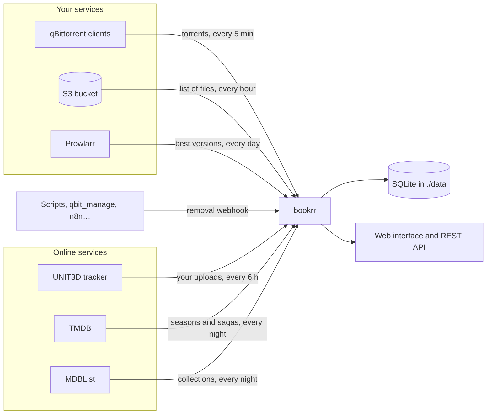
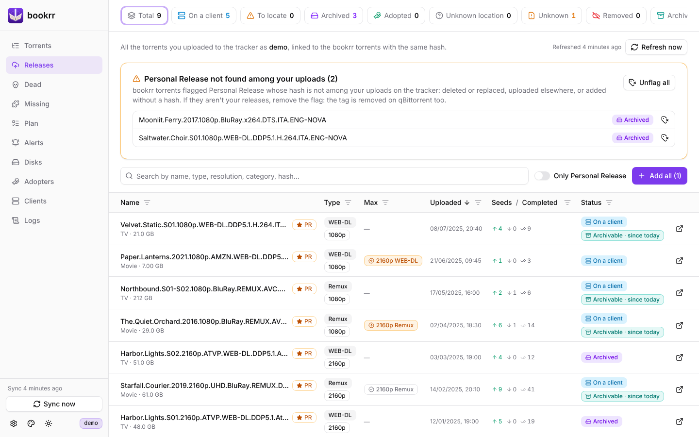
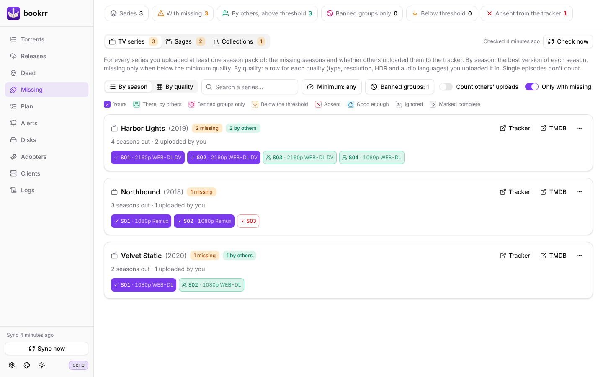
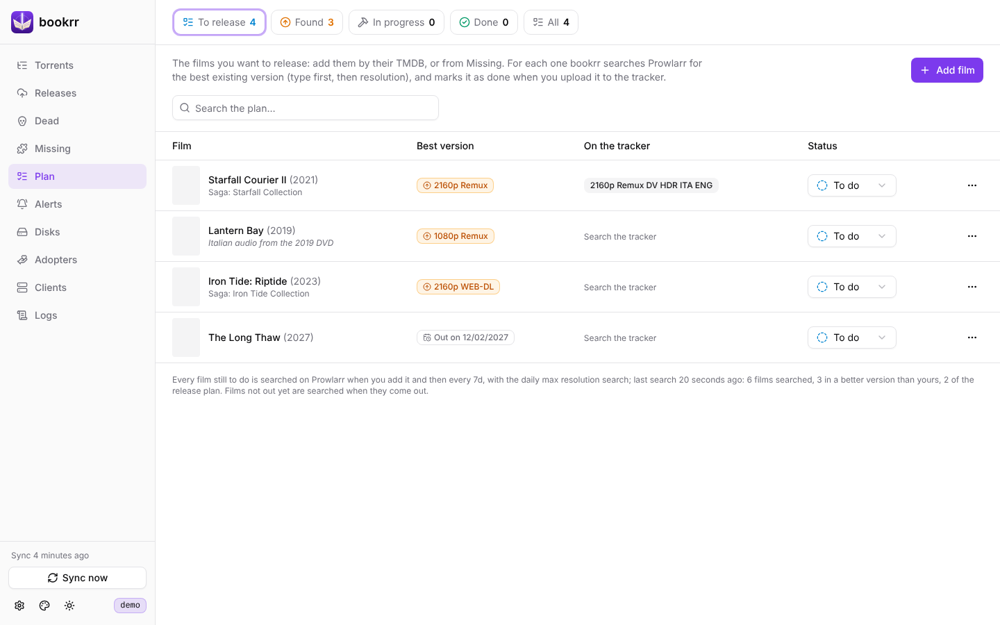
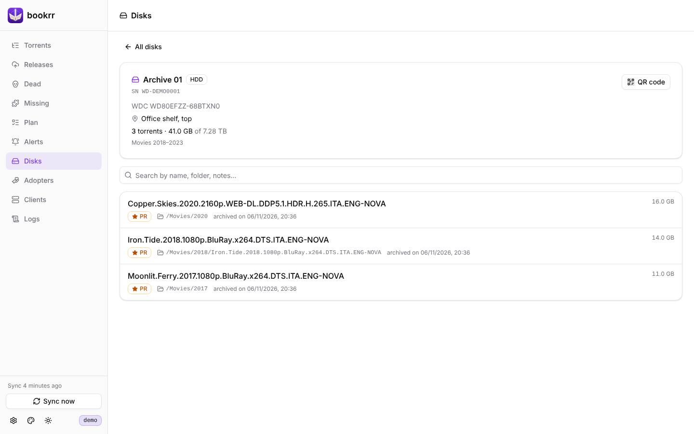
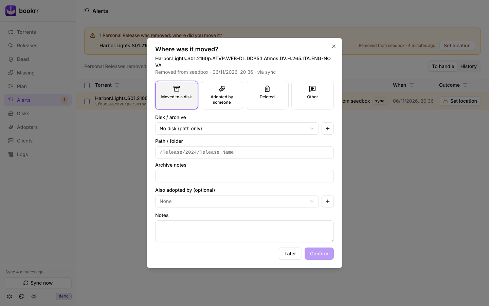
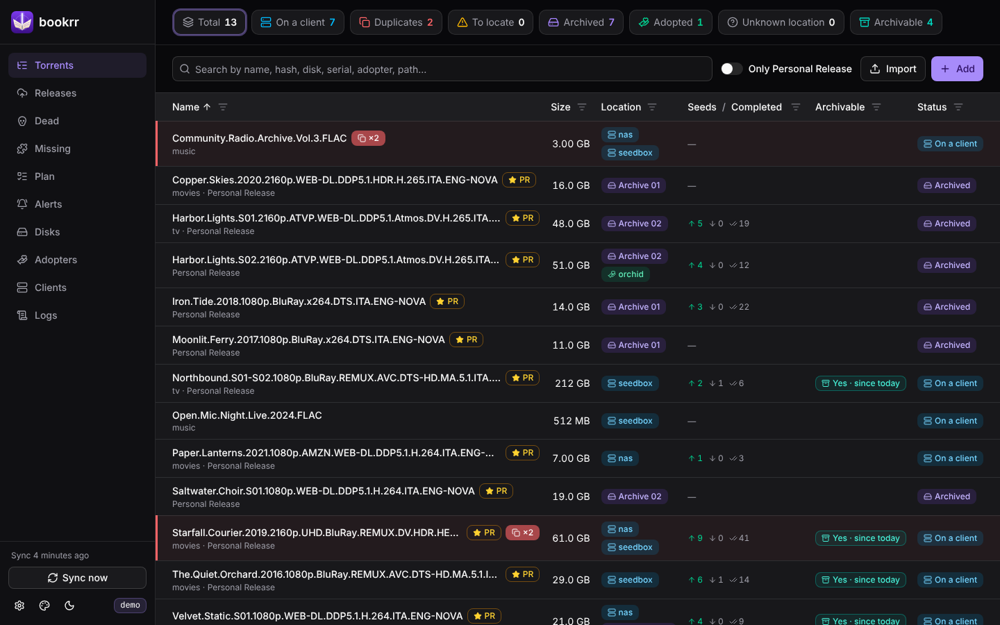

<p align="center"></p>

<h1 align="center">bookrr</h1>

> [!IMPORTANT]
> **Full Vibe Coded.** Every line of bookrr, its code, its tests and this documentation, was written by an AI coding assistant, under the direction of its owner. It is used every day and covered by tests, but read the code before trusting it with your data, and keep a backup of `./data`.

<p align="center"><b>English</b> · <a href="README.it.md">Italiano</a> · <a href="docs/en/README.md">Documentation</a></p>

The inventory of your torrents: **where they are** (on which qBittorrent client, on which archive disk, who adopted them) and **what disappeared** from the clients. For uploaders on a UNIT3D tracker it also keeps the **history of your releases**, finds the **seasons and films you are missing** and the **best version** of each film, and tells you which releases you can **archive**.



## Features

- 📋 **One list** of all the torrents of one or more qBittorrent clients, with search and a **filter on every column**.
- 🧬 **Duplicates**: the same torrent on several clients, where it is still downloading, and removal from one client (with or without the files) from bookrr.
- 🔔 **Removed releases**: when a torrent tagged `Personal Release` disappears from every client, bookrr asks **where you moved it** (disk, adopter, deleted, other). Also through a webhook.
- 💽 **Offline archives**: disks with serial number, model, capacity and location, **SMART data** pasted from `smartctl` or CrystalDiskInfo, and a **QR code** to stick on each disk that opens its list of torrents.
- ☁️ **Cloud archives on S3** (Scaleway and compatible services), **read-only**: bookrr recognizes by itself what you moved to the bucket.
- 🤝 **Adopters**: the people who adopted your releases and keep seeding them.
- 📥 **CSV/Excel import** of the torrents already archived.
- 🚀 **Release history** from the UNIT3D tracker (anonymous uploads included) with seeders and completions, linked to the torrents in bookrr; the **hash** of the torrents added without one is found on the tracker.
- 🧩 **Missing seasons and films**: for your series, for the **sagas** of your films (TMDB) and for the **collections** you follow (MDBList), what is missing in your quality, with minimum quality, banned groups and your choices.
- 📺 **Max resolution**: with Prowlarr, the films that exist in a better version than yours.
- 📝 **Release plan**: the films you want to release, with their best existing version, marked done when you upload them.
- 📦 **Archivable releases**: your releases still on a client that others are already seeding.
- 📜 **Logs** page, with one file per day kept in the data folder.
- 🌗 Light and dark theme and six **lightsaber colors** for the logo and the buttons.
- 🐳 One container of about 9 MB, for **amd64, 386, arm64, armv7 and armv6** (Raspberry Pi included).

## How it fits together



Only the qBittorrent clients are needed: every other service is optional and enables its own pages.

## Screenshots

| | |
|---|---|
|  **Releases**: your uploads on the tracker, with the best existing version (Max) |  **Missing**: the best version of each season against your minimum quality |
|  **Plan**: the films to release and what Prowlarr found |  **Disk page**: the torrents on a disk, opened by its QR code |
|  **Alerts**: where did the removed release go? |  **Dark theme** |

More in the [documentation](docs/en/README.md).

## Installation

### Docker Compose (recommended)

```bash
mkdir bookrr && cd bookrr
curl -O https://raw.githubusercontent.com/TehMaat/bookrr/main/docker-compose.yml
docker compose up -d
```

Open `http://SERVER-IP:8080`, go to **Clients** and add your qBittorrent clients (Web UI address, username and password). The tracker, TMDB, MDBList and Prowlarr are connected from **Settings** (⚙️ at the bottom left). Everything is saved in `./data`.

### Docker run

```bash
docker run -d --name bookrr --restart unless-stopped \
  -p 8080:8080 -v "$PWD/data:/data" -e TZ=Europe/Rome \
  ghcr.io/tehmaat/bookrr:latest
```

### Image tags and updates

The image `ghcr.io/tehmaat/bookrr` is multi-architecture: Docker pulls the right one for your machine. The running version is shown at the bottom of the sidebar.

| Tag | Follows |
|---|---|
| `latest` | every release from `main` |
| `0.24` | the bug fixes of 0.24 only |
| `0.24.0` | exactly that version |

To update: `docker compose pull && docker compose up -d`. The database is migrated by itself at start; make a copy of `./data` first.

### Build the image yourself

```bash
git clone https://github.com/TehMaat/bookrr.git && cd bookrr
docker compose up -d --build
```

> Building locally needs a `node` image for your platform: on 32-bit x86 machines use the published image, or build from another machine with `docker buildx build --platform linux/386`.

### Without Docker

With Go 1.24+ and Node 22+ you get a single binary with the interface inside:

```bash
git clone https://github.com/TehMaat/bookrr.git && cd bookrr
cd web && npm ci && npm run build && cd ..
go build -o bookrr ./cmd/bookrr
BOOKRR_DATA_DIR=./data ./bookrr
```

## Configuration

Most options are set from **Settings** in the interface, and apply right away without a restart; each tab has a **Test** button to check address and key before saving. An option set as an environment variable (see [`docker-compose.yml`](docker-compose.yml)) **takes precedence**: Settings shows it locked. Address, data folder, login and webhook token are environment variables only.

| Variable | Default | Description |
|---|---|---|
| `BOOKRR_SYNC_INTERVAL` | `5m` | How often to read the clients (minimum `30s`). |
| `BOOKRR_RELEASE_TAG` | `Personal Release` | The qBittorrent tag that marks your releases (case insensitive). |
| `BOOKRR_S3_SCAN_INTERVAL` | `1h` | How often to read the S3 buckets of the cloud archives (minimum `1m`). |
| `BOOKRR_UNIT3D_URL` / `BOOKRR_UNIT3D_API_KEY` | — | Address of the UNIT3D tracker (e.g. `https://tracker.example`) and your API key: hash lookup and release history. |
| `BOOKRR_UNIT3D_RELEASES_INTERVAL` | `6h` | How often to read your uploads again (minimum `15m`). |
| `BOOKRR_TMDB_API_KEY` | — | [TMDB](https://www.themoviedb.org/settings/api) API key (v3) or read access token (v4): with the tracker, missing seasons and saga films; alone, enough to add films to the plan. |
| `BOOKRR_MDBLIST_API_KEY` | — | [MDBList](https://mdblist.com) API key (free, in your account preferences): with the tracker and TMDB, the collections. |
| `BOOKRR_MISSING_CHECK_AT` | `04:00` | Time of the nightly missing check (local time, see `TZ`). |
| `BOOKRR_PROWLARR_URL` / `BOOKRR_PROWLARR_API_KEY` | — | Address of [Prowlarr](https://prowlarr.com) (e.g. `http://prowlarr:9696`) and its API key (Settings → General): with the tracker, max resolution and plan searches. |
| `BOOKRR_PROWLARR_RECHECK` | `7d` | How often to search each film again (minimum `1d`; hours work too, e.g. `36h`). |
| `BOOKRR_LOG_RETENTION` | `30d` | How many days to keep the log files (minimum `1d`, `0` = forever). |
| `BOOKRR_LOG_MAX_SIZE` | `50MB` | Maximum size of a log file; past it the day goes on in a new file (minimum `1MB`, `0` = no limit). |
| `BOOKRR_LOG_LEVEL` | `info` | Minimum level written: `debug`, `info`, `warn` or `error`. |
| `BOOKRR_AUTH_USER` / `BOOKRR_AUTH_PASSWORD` | — | *Environment only.* When set, the interface and the API ask for a login (HTTP Basic). |
| `BOOKRR_WEBHOOK_TOKEN` | — | *Environment only.* When set, the webhook wants the token (`?token=…`, `X-Bookrr-Token` header or `Authorization: Bearer …`). |
| `BOOKRR_LISTEN` | `:8080` | *Environment only.* Listening address. |
| `BOOKRR_DATA_DIR` | `/data` | *Environment only.* Folder of the database and of the logs. |
| `TZ` | — | Time zone of the logs, of the day change and of the nightly check (e.g. `Europe/Rome`). |

> [!WARNING]
> The passwords of the qBittorrent clients and the keys of the S3 buckets and of the services are stored in plain text in the database in `./data`: protect that folder. If bookrr is reachable from outside your network, set a login and a webhook token.

## Documentation

| Guide | |
|---|---|
| [Clients, duplicates and alerts](docs/en/clients-and-alerts.md) | sync, removed releases, moves and adoptions, removal webhook |
| [Archives](docs/en/archives.md) | disks and QR codes, SMART data, S3 buckets, CSV import |
| [Tracker](docs/en/tracker.md) | hash lookup, release history, archivable releases |
| [Max resolution and release plan](docs/en/prowlarr-and-plan.md) | Prowlarr searches |
| [Missing seasons and films](docs/en/missing.md) | series, sagas, collections, minimum quality, banned groups |
| [Logs](docs/en/logs.md) | log files and the Logs page |
| [API](docs/en/api.md) | the REST API |
| [Development](docs/en/development.md) | build, tests, project structure, demo and screenshots |
