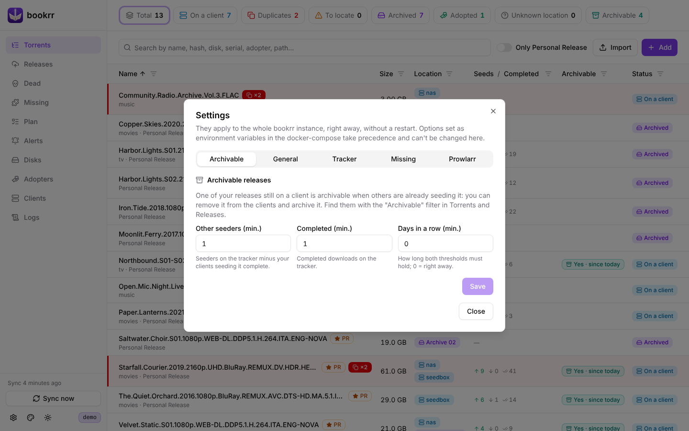

<h1 align="center">bookrr documentation</h1>

> [!IMPORTANT]
> **Full Vibe Coded.** Every line of bookrr, its code, its tests and this documentation, was written by an AI coding assistant, under the direction of its owner. Read the code before trusting it with your data, and keep a backup of `./data`.

<b>English</b> · <a href="../it/README.md">Italiano</a> · <a href="../../README.md">Back to the README</a>

Installation and configuration are in the [README](../../README.md#installation). The guides:

| Guide | |
|---|---|
| [Clients, duplicates and alerts](clients-and-alerts.md) | sync, duplicates, removed releases, moves and adoptions, adopters, removal webhook |
| [Archives](archives.md) | disks and QR codes, SMART data, cloud archives on S3, CSV import |
| [Tracker](tracker.md) | hash lookup on UNIT3D, release history, archivable releases |
| [Max resolution and release plan](prowlarr-and-plan.md) | the best existing version of your films, with Prowlarr, and the films to release |
| [Missing seasons and films](missing.md) | series, sagas, collections, views, minimum quality, choices, banned groups |
| [Logs](logs.md) | log files and the Logs page |
| [API](api.md) | the REST API |
| [Development](development.md) | build, tests, demo and screenshots, project structure, versions |

## The interface

The menu on the left has a page for each part of bookrr; the counters at the top of a page filter its list. ⚙️ at the bottom left opens **Settings**, 🎨 picks the color of the logo and the buttons (a lightsaber color, remembered by the browser), ☀️ the light, dark or system theme.

  
  
  
  
  
  

