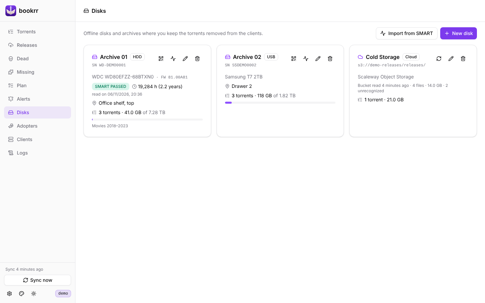
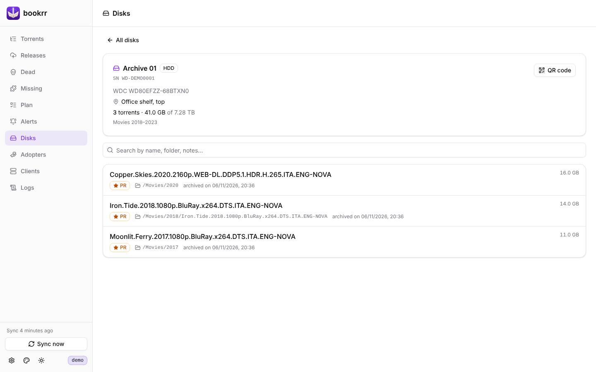
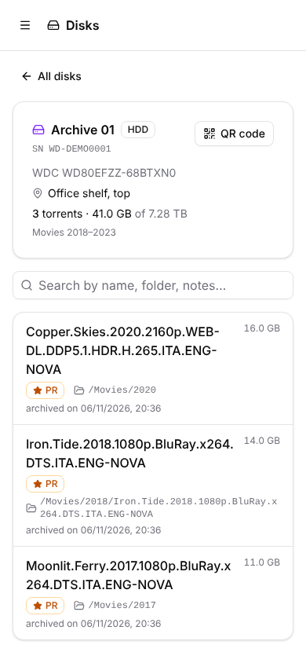
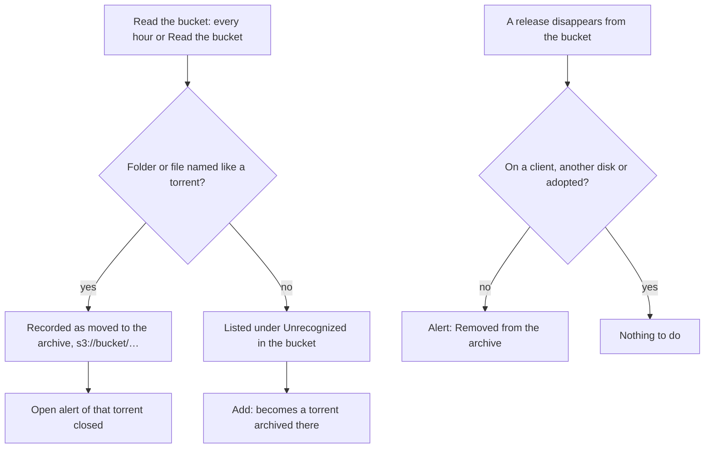

# Archives

[Documentation](README.md) · [Italiano](../it/archivi.md)



The **Disks** page holds the disks and other archives where you keep the torrents removed from the clients: name, kind (HDD, SSD, NVMe, USB, NAS, Tape, Cloud, Other), **serial number**, model, capacity, location and notes, with how much of each disk your archived torrents fill. A move is recorded on a torrent with its disk and folder, from the torrent details or when bookrr asks where a removed release went.

## QR codes on the disks

Every physical disk has its own page with the torrents archived on it, searchable by name, folder and notes. From the QR icon you print a label with the QR code of that page: scan it with your phone and you see what is on the disk you are holding.

| | |
|---|---|
|  |  |

In the QR code window you set the **address of bookrr on your network** (e.g. `http://192.168.1.10:8080`): the one other devices use, useful when the container is in a Docker network. It is saved for every disk. You can download the QR code as SVG or print a 50 mm label.

## SMART data

*Import from SMART* reads the SMART report of a disk and creates the disk, or updates the one with the same serial number (the button on a disk's card updates that disk). Accepted formats:

- `smartctl -a /dev/sdX` or `smartctl -x /dev/sdX` (SATA, NVMe, SAS);
- `smartctl -a -j /dev/sdX` (JSON);
- the text copied from CrystalDiskInfo (*Edit → Copy*).

Model, serial number, capacity, kind (HDD/SSD/NVMe), firmware, SMART health and power-on hours are copied, with the date of the read; name, location and notes stay as you set them, and a kind like `USB` or `NAS` is not overwritten.

From a script, send the report as it is:

```bash
sudo smartctl -a -j /dev/sdb | curl -X POST --data-binary @- -H "Content-Type: text/plain" \
  "http://bookrr:8080/api/disks/smart?label=Archive%2003"
```

| Parameter | Notes |
|---|---|
| `id` | update the disk with this id instead of looking it up by serial number |
| `new=1` | always create a new disk |
| `label` | name of the disk when created (default: the model) |
| `dryRun=1` | show the result without saving |

Without `id` or `new=1`, a report with no serial number is refused.

## Cloud archives on S3

An archive of kind **Cloud** can be linked to an S3 bucket: in **Disks → New disk** choose *Cloud*, turn on *Link an S3 bucket* and fill in:

| Field | Notes |
|---|---|
| Service | *Scaleway Object Storage* (pick the region: `fr-par`, `nl-ams`, `pl-waw`) or *Other S3 service* with endpoint and region (AWS, MinIO, Backblaze B2, Cloudflare R2, Wasabi…) |
| Bucket | the name only, e.g. `my-releases` |
| Folder | optional: reads only this folder of the bucket (e.g. `releases/`) |
| Access key / Secret key | the API key; the secret key is never shown again |

The link is **read-only**: bookrr only uses the list of files (`ListObjectsV2`); it doesn't download, write or delete anything. Still, use a key that can only read: on Scaleway create an IAM application with the **ObjectStorageReadOnly** permission on the bucket's project, and generate the API key with that project as *preferred project*. *Test connection* checks the key by reading the first page of the bucket.



After saving, every hour (`BOOKRR_S3_SCAN_INTERVAL`) or with *Read the bucket*:

- every **folder or file named like a torrent** (the name qBittorrent gives it), at any depth (`Movies/Some.Release/` as well as `Some.Release/`), is recorded as **moved to the archive**, with the path `s3://bucket/…`; if the torrent had an open alert, it is closed;
- if you move a release there before removing it from the client, the removal opens no alert (as for the moves recorded by hand);
- if a release disappears from the bucket and is on no client, on no other disk and not adopted, an alert opens ("Removed from *archive name*");
- what matches no torrent shows on the archive's page, under *Unrecognized in the bucket*: *Add* turns it into a torrent (named as in the bucket) archived there, and with UNIT3D configured bookrr looks up its hash on the tracker.

The moves found in the bucket update by themselves and can't be deleted by hand; if you record the same torrent on the same archive by hand, your record wins. Changing bucket, endpoint or folder forgets what was found in the old bucket, without alerts. An unreachable bucket changes nothing: the error shows on the archive's card.

## CSV import

In **Torrents → Import** you load (or paste) a CSV file with many torrents already moved to disk. Separator `;`, `,` or tab, first row with the headers (there is a template to download):

| Column | Notes |
|---|---|
| `Name` | required |
| `Hash` | optional, 40 or 64 hex characters |
| `Size` | `12.5 GB`, `1.5 TB`, bytes… |
| `Tags` | comma separated |
| `Personal Release` | yes/no; when empty, the switch in the window applies |
| `Notes` | |
| `Disk` | name or serial number of a disk already in bookrr; when empty, the disk chosen in the window applies |
| `Path`, `Archive notes` | at least the disk or the path is needed |
| `Adopted by` | name of an adopter already in bookrr |

The Italian headers of older files work too (`Nome`, `Dimensione`, `Tag`, `Note`, `Disco`, `Percorso`, `Note archivio`, `Adottato da`), and so does `sì`/`no`.

Every row is checked before the import, by the server too (hash already known, repeated in the file…). The import is all or nothing: if a row is wrong nothing is written. The **Add** form and the import share the same code (`POST /api/torrents` and `POST /api/torrents/import` with the same fields), so the saved data is the same. With a tracker configured, torrents imported without a hash are looked up on it (see [Tracker](tracker.md#hash-lookup)).
