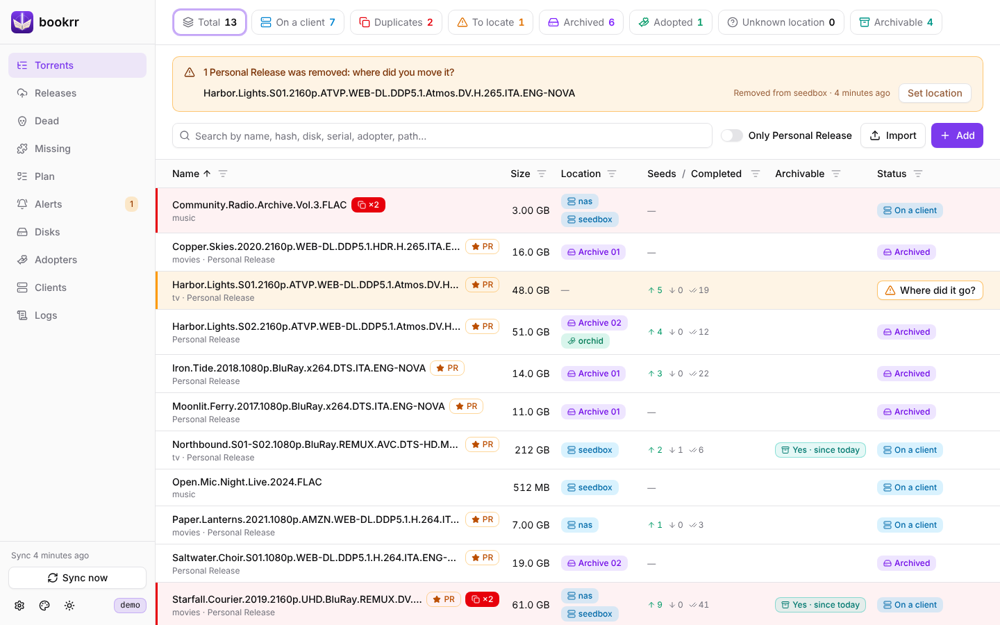
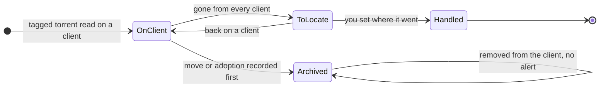
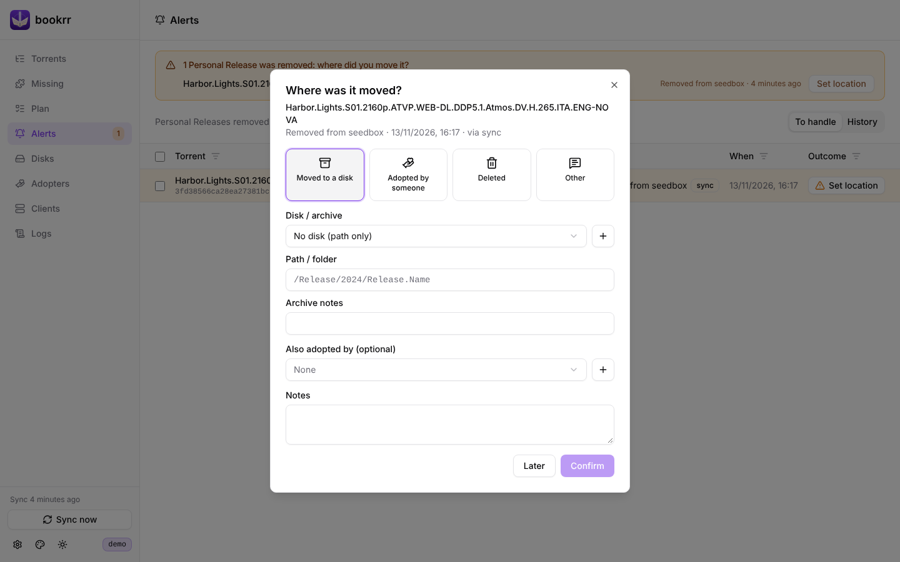
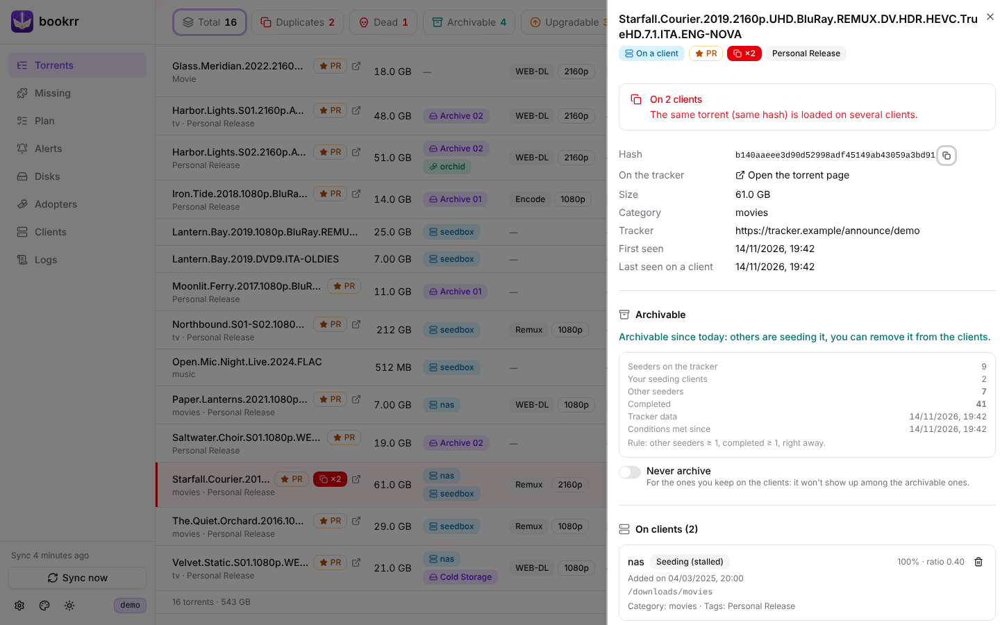

# Clients, duplicates and alerts

[Documentation](README.md) · [Italiano](../it/client-e-segnalazioni.md)



## Sync

Every `BOOKRR_SYNC_INTERVAL` (5 minutes) bookrr reads `/api/v2/torrents/info` from every enabled client and compares it with the previous read:

- a torrent on several clients is marked as a **duplicate**: the **Duplicates** counter shows them with the clients where they are still downloading, and once a torrent is complete everywhere you can **remove it from one client**, with or without its files (bookrr warns you when the other client uses the same path);
- when a torrent with the release tag disappears from **every** client, bookrr opens an **alert** (*To locate*) and highlights the row;
- if it comes back on a client, the alert closes by itself;
- torrents without the tag and without data of yours (moves, adoptions, notes) are simply forgotten when they disappear.

An unreachable client raises **no** alerts: its torrents stay as they were until the next successful read. **Sync now**, at the bottom of the sidebar, reads the clients right away.

A client can also have a **Wayfinderr** (address and API key, in its dialog): the .torrent files of the plan completed on it are sent there, see [Handing the .torrent over to Wayfinderr](prowlarr-and-plan.md#handing-the-torrent-over-to-wayfinderr).



Every list has a filter on each column (the funnel next to the title): text, size and date ranges, clients, disks, adopters and statuses. The **Only Personal Release** switch hides the rest.

## Moves and adoptions

Recording that a torrent was **moved to a disk** or **adopted** by someone answers the question "where did it go?":

- if there is an open alert, it is closed with that destination;
- on the **Alerts** page you can select several (Shift+click selects a range) and give all of them the same destination at once;
- if you record it while the torrent is still on a client, removing it from the client opens no alert: it goes in the history as already handled.



The destination is one of *Moved to a disk* (disk and folder), *Adopted by someone*, *Deleted* or *Other* with a note. The torrent details (click a row) show where it is, its tracker data, its moves and adoptions, your notes and tags.



## Adopters

On the **Adopters** page you keep the people who adopted your releases and keep seeding them, with a contact and notes. Each torrent can have one or more adopters, chosen from a menu; from an adopter's card you can add torrents one click each.

## Removal webhook

To get the alert right away, without waiting for the sync, have this endpoint called when a torrent is deleted:

```
POST /api/webhook/qbit
```

It accepts JSON, a form or a query string. Fields:

| Field | Required | Notes |
|---|---|---|
| `hash` | yes | info hash (also `infohash`, `info_hash`, `hash_v1`) |
| `name` | | torrent name |
| `tags` | | comma separated list or JSON array |
| `category`, `size` | | |
| `client` | | client name **as set in bookrr**: tells bookrr which client it was removed from |

```bash
# form
curl -X POST "http://bookrr:8080/api/webhook/qbit?token=SECRET" \
  -d hash="%I" -d name="%N" -d tags="%G" -d category="%L" -d client="seedbox"

# JSON
curl -X POST http://bookrr:8080/api/webhook/qbit \
  -H "Content-Type: application/json" -H "X-Bookrr-Token: SECRET" \
  -d '{"hash":"0123…","name":"My.Release.2024","tags":["Personal Release"],"client":"seedbox"}'
```

An alert opens only if the torrent has the release tag (in the payload or already known to bookrr) and is on no other client. qBittorrent has no "run on removal" option of its own: the webhook is meant for scripts, qbit_manage, n8n, Home Assistant and the like. The periodic sync catches every removal anyway. The **Clients** page shows the command with your address.
