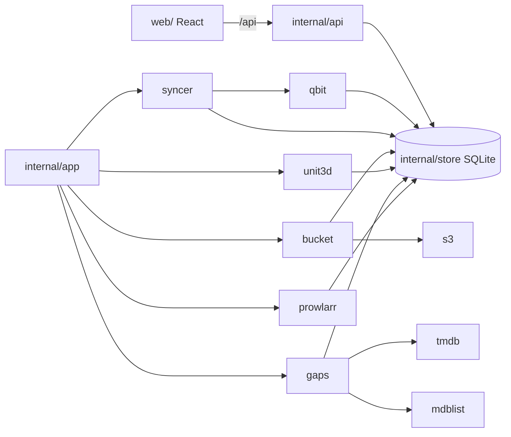

# Development

[Documentation](README.md) · [Italiano](../it/sviluppo.md)

Requirements: Go 1.24+, Node 22+.

```bash
# backend (creates ./data/bookrr.db)
BOOKRR_DATA_DIR=./data BOOKRR_LISTEN=:8080 go run ./cmd/bookrr

# frontend with hot reload on http://localhost:5173 (proxy to :8080)
cd web && npm install && npm run dev

# full build: the frontend is embedded in the binary
cd web && npm run build && cd .. && go build -o bookrr ./cmd/bookrr

# tests and type check
go test ./...
cd web && npm run lint
```

## Demo and screenshots

`scripts/demo` runs bookrr with made-up data: two qBittorrent clients, a UNIT3D tracker, TMDB, MDBList, Prowlarr and an S3 bucket are faked in the same process, and the data is entered through bookrr's own API. Every title, release group and user is invented. It is how the screenshots of this documentation are made:

```bash
cd web && npm run build && cd ..
go run ./scripts/demo -listen 127.0.0.1:8080       # waits for the fake searches, then logs "demo ready"
node scripts/demo/screenshots.mjs http://127.0.0.1:8080   # writes docs/screenshots/*.png
```

The screenshot script needs [Playwright](https://playwright.dev) with Chromium (`npm i -g playwright && npx playwright install chromium`). The demo uses a new temporary data folder each time (`-data` to choose one).

## Project structure

| Folder | What it does |
|---|---|
| `cmd/bookrr` | entry point: configuration, database, services, web server |
| `internal/api` | REST API, webhook, static files |
| `internal/app` | starts and restarts the background services when the configuration changes |
| `internal/config` | environment variables and options of the Settings |
| `internal/store` | SQLite database (modernc.org/sqlite, pure Go, no CGO) and its migrations |
| `internal/syncer` | periodic read of the qBittorrent clients |
| `internal/qbit` | minimal client of the qBittorrent Web API |
| `internal/bucket`, `internal/s3` | read-only S3 client (ListObjectsV2, SigV4) and the reads of the cloud archives |
| `internal/smart` | SMART reports (smartctl, CrystalDiskInfo) |
| `internal/unit3d` | UNIT3D tracker: hash lookup, release history, release names and qualities |
| `internal/gaps` | missing seasons, saga films and collection films |
| `internal/tmdb`, `internal/mdblist` | minimal clients of The Movie Database and MDBList |
| `internal/prowlarr` | Prowlarr searches: max resolution and release plan |
| `internal/logs` | log files, one per day |
| `web/` | React + Vite + Tailwind + shadcn/ui frontend |
| `scripts/demo` | the demo and the screenshots |



The logo and its colors are defined in `web/src/lib/accent.ts`; after changing them, `cd web && npm run logos` writes `docs/logo/` and `web/public/favicon.svg` again.

## Versions and releases

The version lives in `VERSION` and shows at the bottom of the sidebar. When a pull request is merged into `main`, the CI publishes the `X.Y.Z` and `X.Y` images and creates the `vX.Y.Z` tag. Every pull request that changes what users run bumps `VERSION`: patch for fixes and small changes, minor for new features (and, while on 0.x, for breaking changes). Docs-only, CI-only and test-only changes don't bump.

The *Cleanup branches* workflow deletes the branch of a pull request as soon as it is merged and, every week, the branches whose pull request was merged at their last commit or that have nothing left that isn't in `main`; branches with an open pull request or newer commits are kept. Run it by hand from the Actions tab with *dry run* to see what it would delete.
