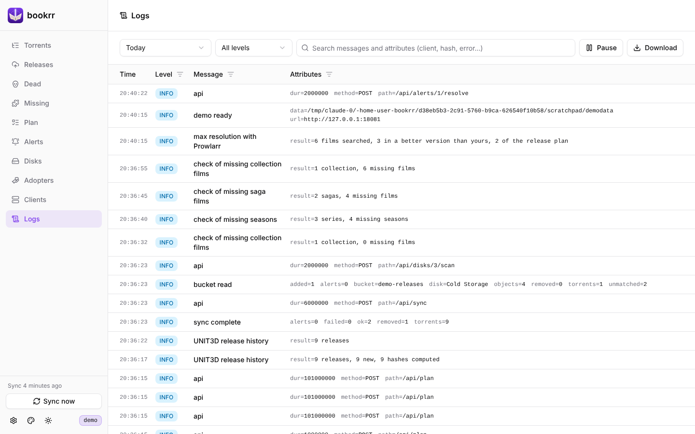

# Logs

[Documentation](README.md) · [Italiano](../it/log.md)



Every message of bookrr goes to the container's stderr (`docker logs bookrr`, as usual) and to the **file of the day** in the data folder: `./data/logs/bookrr-YYYY-MM-DD.log` (local date, see `TZ`), so it stays after restarts and updates of the container. The files are [JSON Lines](https://jsonlines.org): one line per message with date and time, level (`DEBUG`, `INFO`, `WARN`, `ERROR`), message and attributes (`err`, `client`, `hash`…), readable from outside too:

```bash
tail -f data/logs/bookrr-$(date +%F).log | jq -c '{time, level, msg}'
```

At midnight bookrr moves to the new file; when a file gets bigger than `BOOKRR_LOG_MAX_SIZE` the day goes on in `bookrr-YYYY-MM-DD.2.log`, `.3.log`… At start and on every new day it deletes the files older than `BOOKRR_LOG_RETENTION` (30 days). Retention, size and level can also be changed from **Settings → General** and apply right away. The messages written before the data folder is ready (errors in the configuration or in the folder itself) go to stderr only. API keys and passwords never end up in the logs.

The **Logs** page shows the messages of a day (today by default), newest first: time, level, message and attributes, with a filter on every column, the **minimum level** and a **search** in the text (done by the server, on the whole file). On the current day the page updates by itself every 5 seconds with the new lines (**Pause** stops it); **Download** downloads the file of the day as it is. When a day has more than 5000 messages matching the search, the page shows the last ones.

API: `GET /api/logs/files` (the files: name, day, size), `GET /api/logs?day=YYYY-MM-DD&level=warn&q=text` (the lines of the day, filtered; it answers with `next`: with `&after=<next>` it reads only the lines added since), `GET /api/logs/files/{name}` (downloads the file). They are behind the same login as the rest of the API.
