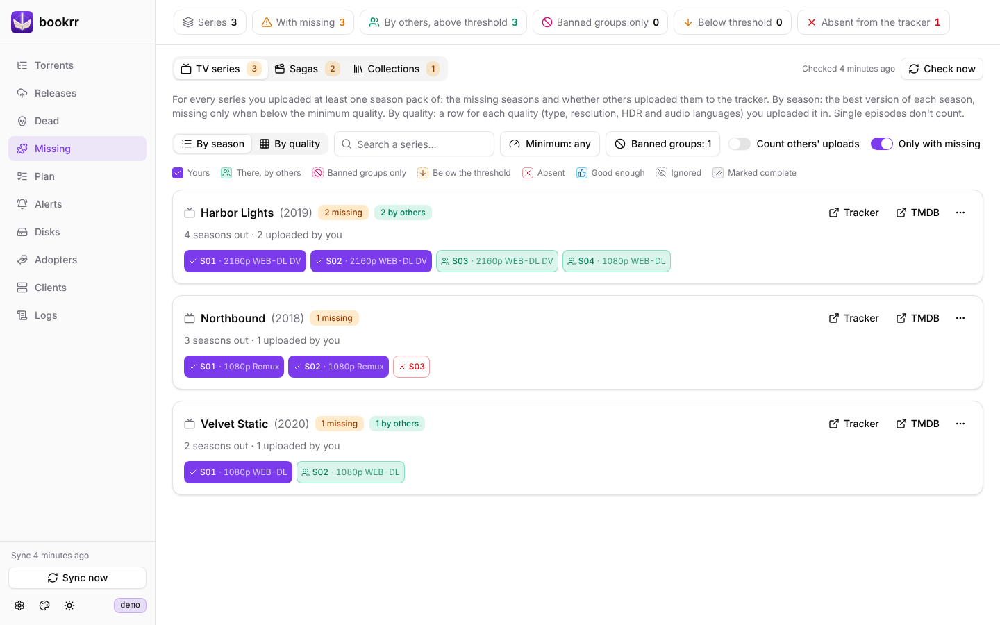
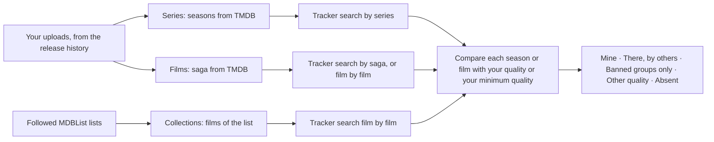
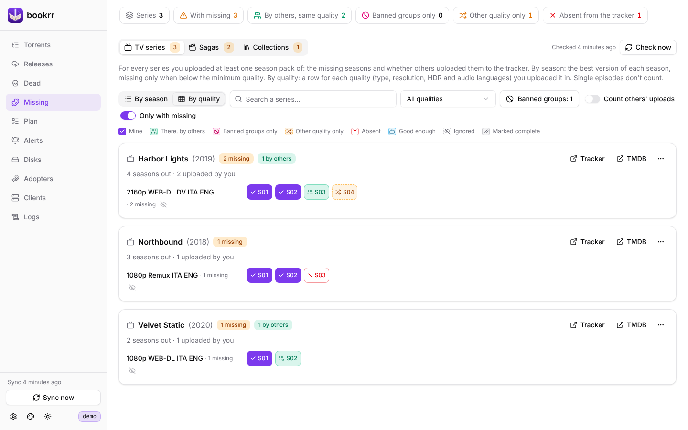
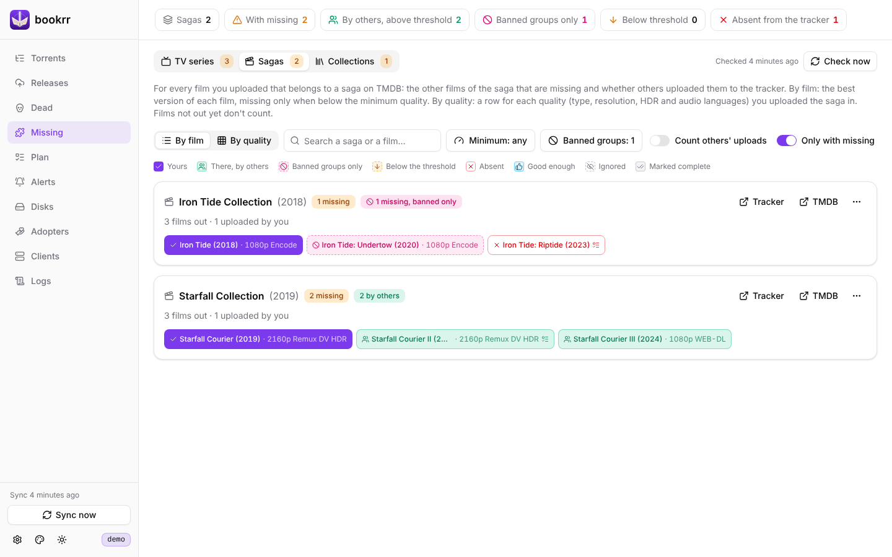
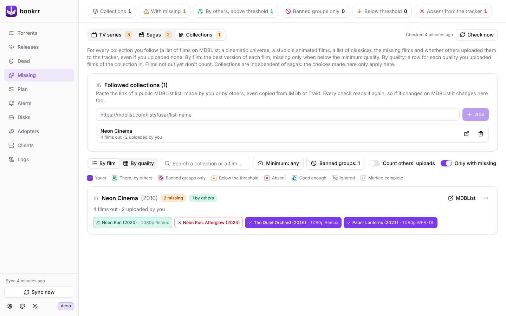

# Missing seasons and films

[Documentation](README.md) · [Italiano](../it/mancanti.md)

With the UNIT3D tracker and `BOOKRR_TMDB_API_KEY` set, the **Missing** page tells you, in its **TV series** tab, for every series you uploaded at least one season of, **which seasons are missing** in your quality and whether others already uploaded them to the tracker; the **Sagas** tab does the same for the **films of the sagas** and the **Collections** tab for the lists of films you follow on MDBList. Without one of the keys the page is off and says what is missing.

## TV series

- only **season packs** count (`S03`, `Season 3`) and **packs of several seasons or of the whole series** (`S01-S05`, `S01-05`, `S01.S02.S03`, `Season 1-3`, `Complete`); **single episodes** (`S01E01`, `S01E01-E10`) are ignored, yours and others'. A `Complete` pack without season numbers counts for the seasons already out when it was uploaded;
- **same quality** = same type (WEB-DL, Remux, Encode… as the tracker gives it) + same resolution + same set of HDR formats (DV, HDR, HLG) + same audio languages. So `2160p WEB-DL DV HDR ITA ENG` is not `2160p WEB-DL DV HDR ITA` nor `2160p WEB-DL HDR ITA ENG`. HDR and languages are read from the name; when the name doesn't give the languages (or says just `MULTI`) the audio tracks of the torrent's *media info* are used;
- the **seasons of the series** come from TMDB (`GET /tv/{id}`), without the specials (season 0) and the seasons not out yet. When the release on the tracker has no TMDB id, bookrr looks it up from the TVDB id (`GET /find/{id}`); if that fails the series shows among the ones **that can't be checked**;
- on the tracker bookrr makes **one search per series** (`GET /api/torrents/filter?tmdbId=…`, every page, with the same care as the release history: one request every 2.5 seconds at most and the parameter that avoids the shared cache). TMDB numbers films and series separately, so only the torrents in the categories of your uploads of the series count. The season number is read from the name.

In the view by quality, every series has a row for each of your qualities and each season is:

| Status | Meaning |
|---|---|
| **Mine** | you uploaded it in this quality |
| **There, by others** | others uploaded it in the same quality |
| **Banned groups only** | others uploaded it in the same quality, but only [banned groups](#banned-groups) |
| **Other quality only** | it is on the tracker, but only in other qualities (listed in the details) |
| **Absent** | it is not on the tracker in any quality |

Clicking a season opens the torrents found, with the link to their tracker page. Every series shows its number of missing seasons (the sum over your qualities) and the links to the series on the tracker and on TMDB; you can search by name, filter by quality and show **only the series with missing seasons**.

## Sagas

For every film you uploaded that belongs to a **saga** on TMDB (a *collection*, like the "Starfall Collection" of the screenshots), the **Sagas** tab shows the other films of the saga in the same quality, with the same statuses as the seasons:

- only the releases in the **films category** count (a tracker category with `Movie` or `Film` in it; without a category, a name with no seasons or episodes and no TVDB id): a film's TMDB id is not a series' one;
- the saga of the film comes from TMDB (`GET /movie/{id}`, field `belongs_to_collection`); films without a saga don't show. When the release has no TMDB id, bookrr looks it up from the IMDb id (`GET /find/tt…`); if that fails the film shows among the ones **that can't be checked**;
- the **films of the saga** come from TMDB (`GET /collection/{id}`), by release date, **without those not out yet** (or without a date), except the ones you uploaded;
- on the tracker bookrr makes **one search per saga** (`GET /api/torrents/filter?collectionId=…`). If it returns nothing, or returns films outside the saga (a tracker that doesn't know the filter), it searches **film by film** (`tmdbId=…`). Only the torrents in film categories count; **same quality** is defined as for the series.

In the cells the film title is written without the part shared by the whole saga; clicking opens the torrents found and the link to the film on TMDB. You can search by saga or film name.

## Collections

A TMDB saga is a film and its sequels; a cinematic universe, a studio's animated films or a list of classics are not sagas. For those there is the **Collections** tab: with `BOOKRR_MDBLIST_API_KEY` you paste the link of a public [MDBList](https://mdblist.com) list (e.g. `https://mdblist.com/lists/user/list-name`, also an IMDb or Trakt list copied on MDBList) and bookrr follows it:

- the films of the collection are those of the list **in the list's order**, read on every check (`GET /lists/{user}/{list}/items/movie`), so when the list changes the collection changes; title and release date come from TMDB, and a film without a TMDB id is looked up by its IMDb id. Films **not out yet** don't count, except those you uploaded;
- a collection always shows, **even if you uploaded none of its films**: in the view by film every film is yours, by others, below the threshold or absent; the view by quality has a row for each quality you uploaded at least one of its films in;
- the tracker doesn't know the lists: bookrr searches **film by film** (`tmdbId=…`), once per film even when it is in several collections;
- collections are **independent of the sagas**: a film can be both in a saga and in a collection, and the choices (accepted, ignored, complete, hidden, minimum quality) made in one don't apply to the other;
- a list deleted or made private on MDBList shows among the **lists not found**. **Stop following** (the bin next to the collection) removes the collection with its results and the choices made on its films; the list on MDBList is not touched.

A new collection is checked right away; the others are updated by the nightly check. The free MDBList plan allows 1000 requests a day: bookrr uses one per collection on every check (plus one when you add it).

## View by season / by film and minimum quality

The grid by quality gets hard to read when you uploaded a saga in several "best" qualities (the first film in 2160p Remux DV, the second that only exists in 1080p Remux): the second film is missing in every 2160p row. So each tab has two views, and the browser remembers the last one (the first time it is the one by part):

- **By season / By film**: one row per series or saga, one cell per season or film with its **best version** (yours, if you have one that reaches the minimum quality; otherwise the best of others that reaches it; otherwise the best one at all). "Best" means, in order: type (Full Disc > Remux > Encode > WEB-DL > WEBRip > HDTV), resolution, HDR (DV counts more than the others), number of audio languages;
- **By quality**: the grid described above, one row for each of your qualities.

The **minimum quality** (the *Minimum* button, one for the series, one for the sagas and one for the collections; each one can have its own from the ⋯ menu) is made of a minimum type, a minimum resolution and a required audio language, each optional. A part is **Yours** if you uploaded it at least in that quality, **There, by others** if someone else did, **Below the threshold** if the tracker has it only in lower qualities, **Absent** if it has nothing. Releases whose languages are unknown (or just `MULTI`) count as if they had the required one. For example, with minimum *Encode* a 1080p Encode by others is fine; with minimum *Remux* it is below the threshold.

Your choices stay after the next checks:

| Choice | Where | Effect |
|---|---|---|
| **Count others' uploads** | switch above the list | what others uploaded (in the same quality, or above the threshold) doesn't count as missing |
| **This one is fine** | details of a cell, on a release by others | the cell becomes *Good enough* and doesn't count as missing; if the torrent leaves the tracker it is missing again |
| **Ignore** | details of a cell | the cell doesn't count as missing (e.g. "it doesn't exist in 4K") |
| **Mark as complete** | ⋯ menu of the series or saga | the parts out so far don't count as missing; a season or film out later does |
| **Hide** | ⋯ menu (series or saga), icon next to a quality | gone from the numbers and from the list; brought back from *Hidden* or from the link under the grid |
| **Add the missing ones to the plan** | ⋯ menu of a saga or collection | the missing films go to the [release plan](prowlarr-and-plan.md#release-plan) |

*This one is fine* and *Ignore* from the view by part apply to every quality; from the view by quality only to that row.

## Banned groups

The **release group** is what comes after the last `-` of the name (`…H.265-NOVA` → `NOVA`) and shows next to each torrent in the details of a cell. With **Banned groups** (above the list, or the ban icon next to a release by others) you list the groups whose releases are not enough for you; the list is one for series, sagas and collections and case doesn't count. When a season or film is on the tracker **only** by banned groups:

- it stays **missing**, even with *Count others' uploads*, but **pink** (*Banned groups only*) instead of green, to give it less priority;
- in the view by part a release by a banned group counts only if there is none by other groups that reaches the minimum quality;
- the "missing" count of the series or saga and the number on the tab leave it out: it is shown apart ("N missing, banned only"), and the series or sagas missing only that go to the end of the list.

Your releases never count as banned. A torrent accepted with *This one is fine* stays accepted even if its group is banned.

## When it runs

The check, series, sagas and collections together, runs **every night** at `BOOKRR_MISSING_CHECK_AT` (04:00), with **Check now** and, when the last one is more than a day old (bookrr was off), 10 minutes after the start. It uses your uploads read by the release history; the results stay in the database with the date of the last check, and a failed check keeps the previous ones (if just one part fails, the others are updated anyway).

Results of a check made by an older version have no versions of the single parts: until the next check (which starts by itself 10 minutes after the start) the view by part shows them by quality.

API: `GET /api/missing/series`, `GET /api/missing/sagas`, `GET /api/missing/lists` (with the followed collections in `sources`), `POST /api/missing/check`, `PUT /api/missing/{series|sagas|lists}/prefs` (minimum quality and "count others' uploads"), `POST`/`DELETE /api/missing/{series|sagas|lists}/marks` (the choices: `hide`, `complete`, `accept`, `ignore`, `threshold`), `PUT /api/missing/banned-groups` with `{"groups": ["GROUP"]}`, `POST /api/missing/lists/sources` with `{"url": "https://mdblist.com/lists/…"}` (follow a collection) and `DELETE /api/missing/lists/sources/{id}`.
