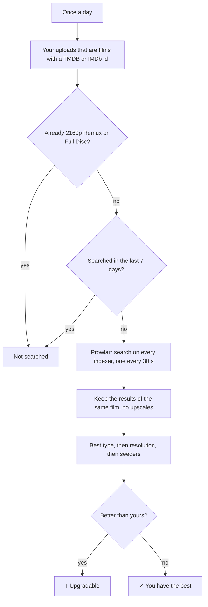
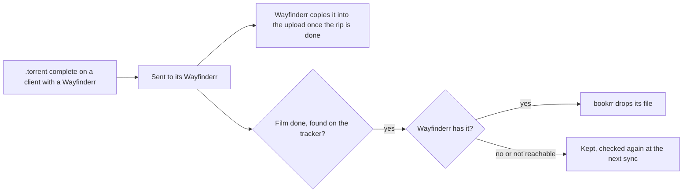
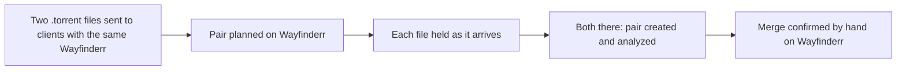

# Max resolution and release plan

[Documentation](README.md) · [Italiano](../it/prowlarr-e-piano.md)

## Max resolution

With `BOOKRR_PROWLARR_URL` and `BOOKRR_PROWLARR_API_KEY` (and the UNIT3D tracker, where the films come from) the **Releases** page gets the **Max** column: the best existing version of every film you uploaded, **in any language** (the audio in your language you add yourself with a mux). "Best" means the **type** first (Remux > Encode > WEB-DL > WEBRip > HDTV; a Full Disc counts as a Remux), then the **resolution**: a 1080p Remux beats a 2160p WEB-DL. It shows:

- **↑ 2160p Remux** (in yellow): the film exists in a better version than your best release of it (a better type, or the same type in a higher resolution); the tooltip says which release and on which indexer, and a click opens its page. The **Upgradable** counter at the top filters these films;
- **✓**: you already have the best existing version (films you have in 2160p Remux or Full Disc are not searched);
- **Not found**: Prowlarr found no release of the film with a known resolution;
- **—**: not a film (series are not searched) or not searched yet.

1. once a day (the first one 15 minutes after the start) bookrr takes your uploads on the tracker that are **films** with a TMDB or IMDb id, except those you already have in 2160p Remux or Full Disc, and searches those never searched or searched more than `BOOKRR_PROWLARR_RECHECK` ago (7 days);
2. for each film it asks Prowlarr `GET /api/v1/search?type=movie&query={ImdbId:tt…}{TmdbId:…}` in the Movies category (2000): Prowlarr searches **all your indexers**. The searches are slow on purpose: one at a time, 30 seconds apart, so the trackers don't feel them (the limits you set in Prowlarr for each indexer still apply);
3. only the results of that film count: with the same TMDB or IMDb id or, when the indexer doesn't give them, with the same title and year (±1) as one of your releases. **Upscales** don't count. Type and resolution are read from the release name (`REMUX`, `WEB-DL`, `WEBRip`, `BluRay` = Encode, `HDTV`); the best type wins, then the highest resolution, then the most seeded. Your films are compared by the type the tracker gives.

If Prowlarr doesn't answer or rejects the key, the search stops (the error shows at the top of the page) and the remaining films are searched the next day.

## Release plan

The **Plan** page is the list of the films you want to release. Add them with **Add film** by their TMDB id, their themoviedb.org link or their IMDb id (it needs `BOOKRR_TMDB_API_KEY`), or from **Missing**: a single film of a saga or collection, or all the missing ones at once from the ⋯ menu of the saga.

For each film bookrr shows:

- the **best version** that exists, searched with Prowlarr when you add it and then every `BOOKRR_PROWLARR_RECHECK` along with the daily max resolution search; the badge is yellow when it is better than what you already uploaded of that film. Films not out yet show their release date and are searched when they come out;
- what is **on the tracker**: your uploads of the film and the torrents of others, with their quality;
- its **download**: the .torrent files you loaded and how they are doing on the clients (see below);
- its **status**: *To do*, *In progress*, *Downloaded*, *Done* or *Dropped*, and an optional note (where to take the audio, the subtitles…).

When you upload the film to the tracker, the next read of the release history (every `BOOKRR_UNIT3D_RELEASES_INTERVAL`) marks it **Done** by itself, also when it was *Downloaded*. *Dropped* keeps it in the plan without searching it again. The counters at the top filter the films to release, those found in a better version, in progress, downloaded, done or all of them.

### Downloading the source

With **Load .torrent** you load on a film the .torrent file of its source: bookrr keeps it, also after sending it, so you can send it again. When the release is a **merge** of two sources (the video from one, the audio or the subtitles from the other) load a second one with **Second .torrent (merge)**; each can have a label (*video*, *audio ITA*) to remember what to take from it. From the ⋯ menu of each torrent you replace it, change its label, save the file or remove it from the film (not from the clients).

**Download** sends the torrents not on a client yet to one of your qBittorrent clients:

- by default it asks which one, with **Advanced** for category, tags and save path (empty, the client's defaults);
- with a **default client** (Settings → Plan) it sends them there without asking; *Send to a client…* in the ⋯ menu of a torrent still lets you choose another one, and the advanced options.

The film goes *In progress*, and its row shows, for each torrent, the client, its state and the progress, read with the clients every `BOOKRR_SYNC_INTERVAL` (and right after sending). When every torrent of the film is complete, it becomes **Downloaded** by itself; with a merge, until both are complete it shows "1 of 2 downloaded". If you put it back to *To do* or *In progress* by hand it stays there, until you send its torrents again. A torrent removed from the client after it was sent is flagged, and *Download* can send it again.

### Handing the .torrent over to Wayfinderr

When [Wayfinderr](https://github.com/TehMaat/wayfinderr) (0.25.0 or later) rips and uploads what a client downloads, give that client its address and API key (Clients → edit → *Wayfinderr*; the key is in the account menu of Wayfinderr, *API key*; **Test connection** checks it too). Each client has its own Wayfinderr, or none.

- After every read of the clients (`BOOKRR_SYNC_INTERVAL`), each .torrent of an open film that is **complete** on a client with a Wayfinderr is sent to it as the **source .torrent** of the film, with its TMDB id and label; Wayfinderr keeps it and copies it into the upload as soon as the rip of that download is done. With a merge each of the two goes on its own, when it is complete. A failure (Wayfinderr down, a wrong key) is shown on the torrent and tried again at the next sync. *Send to Wayfinderr* in the ⋯ menu of a torrent sends it by hand, also again.
- When the film becomes **Done because your release was found on the tracker** (not when you set it by hand), bookrr asks Wayfinderr whether it has the .torrent and, if so, **drops its own file**: the torrent stays on the film with its name, hash and label, marked *On Wayfinderr only*. Torrents never sent to Wayfinderr are never dropped.
- A dropped file is taken back from Wayfinderr when you save it or send it to a client again; loading the same file again puts it back in bookrr.

#### The pair of a merge

With Wayfinderr 0.29.0 or later, the two .torrent files of a merge are also **planned as a pair** on Wayfinderr, before their files arrive: Wayfinderr holds each file as it arrives (instead of uploading it), and once both are there it creates the pair and analyzes it. The merge itself still waits for your confirmation on the Wayfinderr *Merge* page.

- The pair is planned as soon as **Download** sends the two torrents, and after every read of the clients for a film whose two torrents are on (or were sent to) clients with the **same Wayfinderr**: one client, or two whose Wayfinderr has the same address. Each side is the torrent's info hash and name, with its label and the TMDB id of the film; Wayfinderr knows the download from either, also before the source .torrent reaches it. Sending again is harmless: Wayfinderr gives back the pair already planned.
- The row of the film shows how the pair goes, under *Merge*: *Pair planned on Wayfinderr* (waiting for the files), *Paired on Wayfinderr*, *Pair in error on Wayfinderr* (both files arrived, but the pair could not be created: the tooltip says why), *Pair no longer on Wayfinderr* (removed there), *Pair removed from Wayfinderr*, or *Pair not planned on Wayfinderr* with the reason: Wayfinderr down or too old, merging off on it, the two torrents on clients with different Wayfinderr (or one without)... A failure is tried again at the next sync. The pair is read again from Wayfinderr at every sync while it waits.
- The ⋯ menu next to *Merge* plans the pair by hand (**Plan the pair on Wayfinderr**, also again), creates it again after an error (**Create the pair again**), or removes it (**Remove the pair from Wayfinderr**: the files Wayfinderr held stay held there, to pair, upload or delete by hand); a removed pair is not planned again by itself.
- When a .torrent of the film is **replaced or removed**, the pair planned for the old ones is removed from Wayfinderr at once (unless it was paired already), and the new pair is planned once the new torrent is sent. Removing the film from the plan removes its pair too.

API: `GET /api/plan`, `GET /api/plan/lookup?q=…`, `POST /api/plan` with `{"tmdb": "603", "note": "…"}`, `POST /api/plan/bulk` with `{"tmdbIds": […]}`, `PATCH /api/plan/{id}` with `{"status": "doing", "note": "…"}`, `POST /api/plan/{id}/search`, `DELETE /api/plan/{id}`. The .torrent files of a film: `POST /api/plan/{id}/torrents` (form with `file` and an optional `label`; at the first free position, two at most), `PUT /api/plan/{id}/torrents/{position}` (replaces it, same form), `PATCH /api/plan/{id}/torrents/{position}` with `{"label": "…"}`, `DELETE /api/plan/{id}/torrents/{position}`, `GET /api/plan/{id}/torrents/{position}/file` (from Wayfinderr once dropped), `POST /api/plan/{id}/torrents/{position}/wayfinderr` with `{"clientId": 0}` (sends it to the Wayfinderr of that client; 0 the one it was sent to or is on), and `POST /api/plan/{id}/torrents/send` with `{"clientId": 1, "positions": [1], "category": "", "tags": "", "savePath": ""}` (all optional: no client is the default one, no positions are all of them; with two torrents, `merge` in the answer is their pair on Wayfinderr). The pair of a merge on Wayfinderr: `merge` of each film in `GET /api/plan` (`null` if none; `planId` on Wayfinderr, `status` `WAITING`, `PAIRED`, `ERROR`, `GONE`, `REMOVED` or `""` not planned, `pairId`, `message` of Wayfinderr, `error` of the last try, `clientId`, `clientName`, `plannedAt`, `checkedAt`), `POST /api/plan/{id}/merge-plan` with `{"clientId": 0}` (plans it by hand, also again; 0 the client the torrents are on, else the only one with a Wayfinderr), `POST /api/plan/{id}/merge-plan/pair` (creates again a pair in `ERROR`), `DELETE /api/plan/{id}/merge-plan` (removes it from Wayfinderr, not planned again by itself); 400 for a film without two torrents or no Wayfinderr to plan on, 502 when Wayfinderr fails. The default client is `planClientId` of `PUT /api/settings` (0 asks every time).
