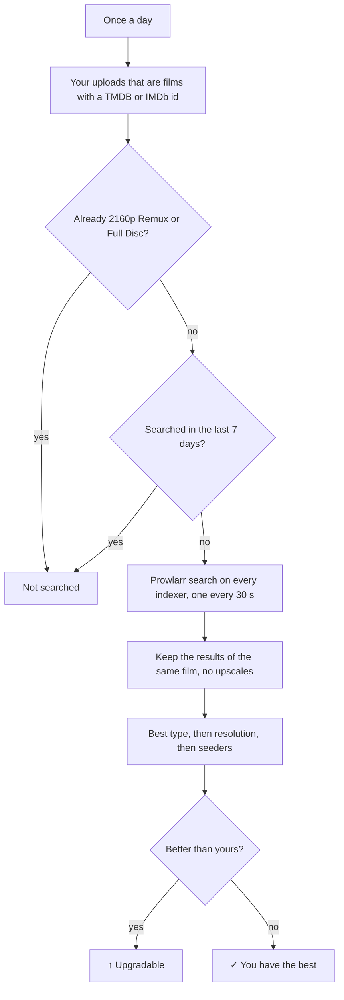
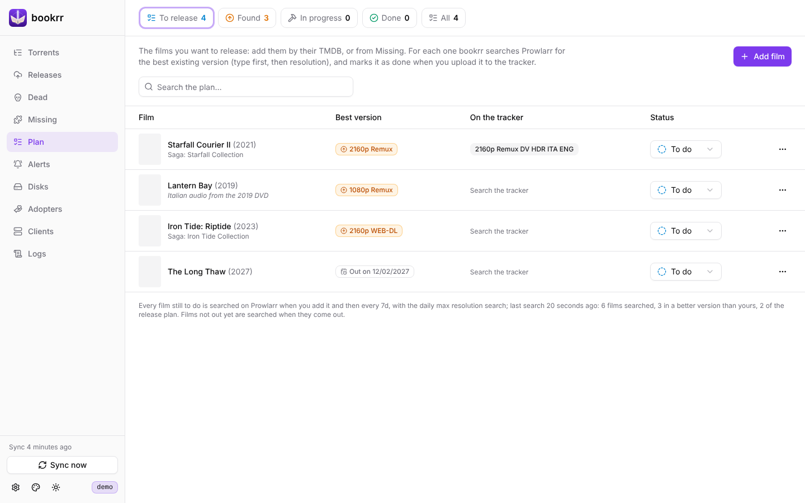

# Max resolution and release plan

[Documentation](README.md) · [Italiano](../it/prowlarr-e-piano.md)

## Max resolution

With `BOOKRR_PROWLARR_URL` and `BOOKRR_PROWLARR_API_KEY` (and the UNIT3D tracker, where the films come from) the **Releases** page gets the **Max** column: the best existing version of every film you uploaded, **in any language** (the audio in your language you add yourself with a mux). "Best" means the **type** first (Remux > Encode > WEB-DL > WEBRip > HDTV; a Full Disc counts as a Remux), then the **resolution**: a 1080p Remux beats a 2160p WEB-DL. It shows:

- **↑ 2160p Remux** (in yellow): the film exists in a better version than your best release of it (a better type, or the same type in a higher resolution); the tooltip says which release and on which indexer, and a click opens its page. The **Upgradable** counter at the top filters these films;
- **✓**: you already have the best existing version (films you have in 2160p Remux or Full Disc are not searched);
- **Not found**: Prowlarr found no release of the film with a known resolution;
- **—**: not a film (series are not searched) or not searched yet.

1. once a day (the first one 15 minutes after the start) bookrr takes your uploads on the tracker that are **films** with a TMDB or IMDb id, except those you already have in 2160p Remux or Full Disc, and searches those never searched or searched more than `BOOKRR_PROWLARR_RECHECK` ago (7 days);
2. for each film it asks Prowlarr `GET /api/v1/search?type=movie&query={ImdbId:tt…}{TmdbId:…}` in the Movies category (2000): Prowlarr searches **all your indexers**. The searches are slow on purpose: one at a time, 30 seconds apart, so the trackers don't feel them (the limits you set in Prowlarr for each indexer still apply);
3. only the results of that film count: with the same TMDB or IMDb id or, when the indexer doesn't give them, with the same title and year (±1) as one of your releases. **Upscales** don't count. Type and resolution are read from the release name (`REMUX`, `WEB-DL`, `WEBRip`, `BluRay` = Encode, `HDTV`); the best type wins, then the highest resolution, then the most seeded. Your films are compared by the type the tracker gives.

If Prowlarr doesn't answer or rejects the key, the search stops (the error shows at the top of the page) and the remaining films are searched the next day.

## Release plan

The **Plan** page is the list of the films you want to release. Add them with **Add film** by their TMDB id, their themoviedb.org link or their IMDb id (it needs `BOOKRR_TMDB_API_KEY`), or from **Missing**: a single film of a saga or collection, or all the missing ones at once from the ⋯ menu of the saga.

For each film bookrr shows:

- the **best version** that exists, searched with Prowlarr when you add it and then every `BOOKRR_PROWLARR_RECHECK` along with the daily max resolution search; the badge is yellow when it is better than what you already uploaded of that film. Films not out yet show their release date and are searched when they come out;
- what is **on the tracker**: your uploads of the film and the torrents of others, with their quality;
- its **status**: *To do*, *In progress*, *Done* or *Dropped*, and an optional note (where to take the audio, the subtitles…).

When you upload the film to the tracker, the next read of the release history marks it **Done** by itself. *Dropped* keeps it in the plan without searching it again. The counters at the top filter the films to release, those found in a better version, in progress, done or all of them.

API: `GET /api/plan`, `GET /api/plan/lookup?q=…`, `POST /api/plan` with `{"tmdb": "603", "note": "…"}`, `POST /api/plan/bulk` with `{"tmdbIds": […]}`, `PATCH /api/plan/{id}` with `{"status": "doing", "note": "…"}`, `POST /api/plan/{id}/search`, `DELETE /api/plan/{id}`.
