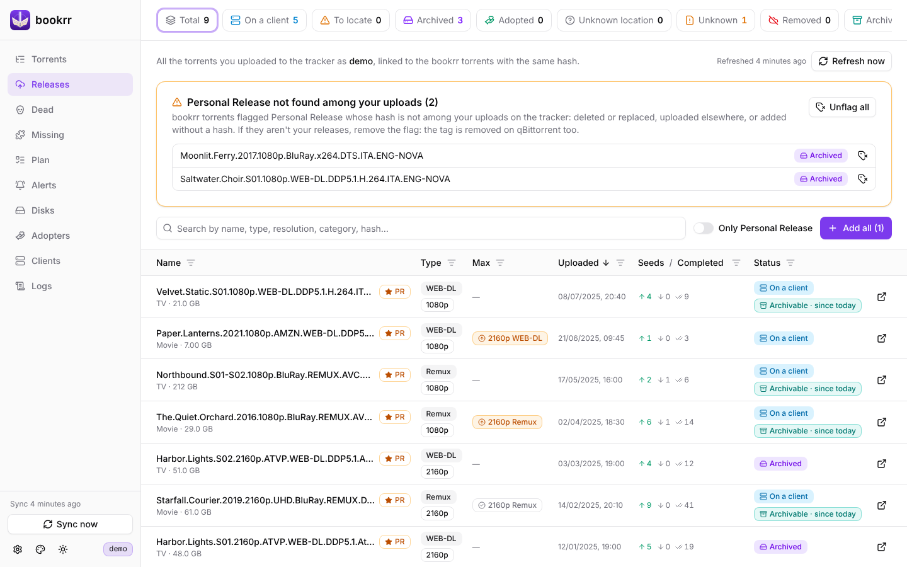
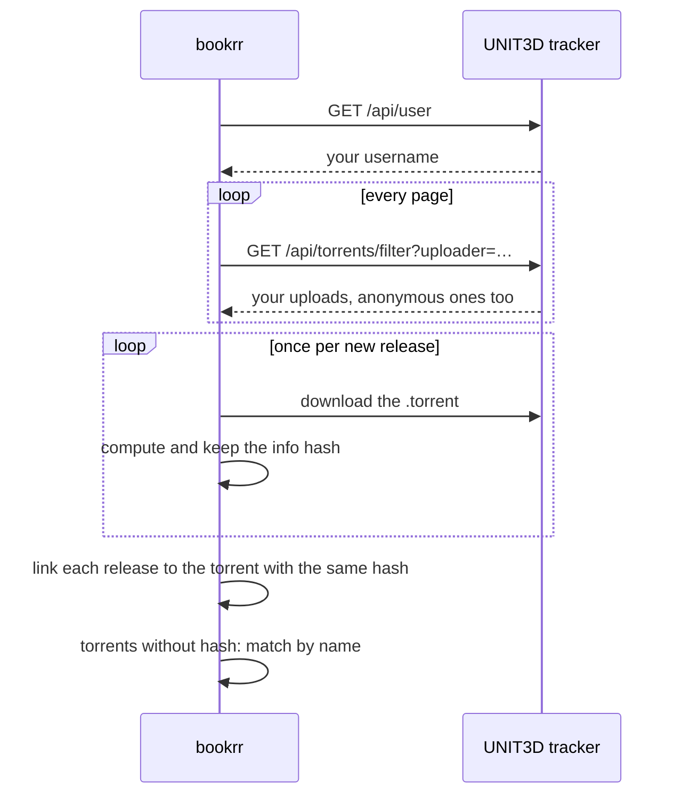
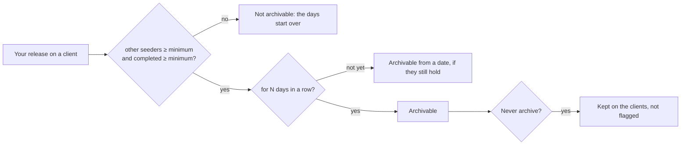

# Tracker

[Documentation](README.md) · [Italiano](../it/tracker.md)

With `BOOKRR_UNIT3D_URL` and `BOOKRR_UNIT3D_API_KEY` (or **Settings → Tracker**) bookrr talks to a UNIT3D tracker: it finds the hash of the torrents added without one, keeps the history of your uploads and tells you which releases you can archive.

UNIT3D allows 30 API calls a minute, so bookrr makes at most one every 2.5 seconds, shared by everything that talks to the tracker: a big import or a first history read finish in the background while you keep using bookrr.

## Hash lookup

Torrents added by hand or imported **without a hash** are looked up on the tracker in the background:

1. bookrr calls `GET /api/torrents/filter?name=…` and picks the torrent with **the same name** (case, dots and underscores don't count); when several have that name it uses the size, otherwise it doesn't guess;
2. when the name is written differently (`Harbor.Lights.S02.2160p.ATVP.WEB-DL.DDP5.1.Atmos.DV.H.265-NOVA` against `Harbor Lights S02 2160p ATVP WEB-DL DD+ 5.1 Atmos DV HEVC-NOVA`) bookrr compares the features of the release, written in any form (`DDP5.1` = `DD+ 5.1`, `HDR10` = `HDR10+`, `H.265` = `x265` = `HEVC`): title, year, season/episode, resolution, source (REMUX, WEB-DL…), service (DSNP, NF…), HDR/DV, video codec and **group** after the `-` must match; the audio and languages of the file name must appear in the tracker's title. What is in only one of the two names doesn't count, except HDR and season. When several torrents match (or the size, if known, differs by more than 5%) it doesn't guess;
3. bookrr downloads the `.torrent` file (with the download link of your API), computes its hash and **keeps the file**: you download it from the torrent details, in *Moved to disk*. If the download fails it uses the hash some UNIT3D versions give (`info_hash` or magnet link);
4. the torrent takes the real hash, with its moves, adoptions and notes, and the link to its page on the tracker. If bookrr already knows that hash (say, because the torrent is still on a client) the two become one.

The lookup starts right after an import and then every hour. Torrents not found show the reason in their details and are looked up again after 24 hours. From the details you can:

- **Search the tracker now**: run the automatic lookup again (`POST /api/torrents/{hash}/lookup-hash`);
- **Pick from the tracker**: list the similar torrents, by words in common, with size, date and link; you can change the search (e.g. just `Starfall Courier 2019`) and with *Use this* the torrent takes hash and `.torrent` file of the one picked (`GET /api/torrents/{hash}/tracker-candidates?q=…`, `POST /api/torrents/{hash}/tracker-match` with `{"id": "123"}`).

The saved `.torrent` file is also at `GET /api/torrents/{hash}/torrent-file`. The **tags** of torrents that are not on a client are changed from their details; for those on a client, qBittorrent's tags count.

> UNIT3D adds the tracker to the .torrent file, so the same content has a different hash on each tracker: bookrr uses the one of the configured tracker, the same you loaded in your client.

## Release history

The **Torrents** page also shows **every torrent you uploaded** (not only those with the tracker's Personal Release flag, anonymous ones included): each upload is on the row of the bookrr torrent with the same hash, and the uploads bookrr knows no torrent for have a row of their own, with the status **Not in bookrr**. The tracker adds the **Type** (WEB-DL, Remux, Encode… and resolution) and **Uploaded** columns, seeders, leechers and completed downloads, and the link to the tracker page. The **Dead** counter shows the uploads still on the tracker that nobody seeds (seed them again from a client or an archive); the filter of the **Status** column has *Not in bookrr* and, under *Tracker*, *Uploaded*, *Not uploaded* and *Removed* (no longer on the tracker). With **Columns** you choose which columns to show; the browser remembers the choice. The old addresses `#releases` and `#dead` still work: the first opens the list filtered on *Uploaded*, newest first.

1. bookrr asks the tracker for your username (`GET /api/user`) and then your uploads (`GET /api/torrents/filter?uploader=…`, every page). The tracker caches those answers for a few minutes, shared by every user: bookrr adds a parameter with your name (ignored by the tracker) so it doesn't get the answer made for someone else, which would lack your anonymous uploads;
2. the API doesn't give the info hash: bookrr downloads the `.torrent` file of each release **once** (the hash doesn't change), computes its hash and keeps it. The first read of many uploads takes a few minutes;
3. each release is linked to the bookrr torrent with **the same hash**, which also gets the `.torrent` file, the link to the tracker page and, if missing, the size. Torrents added **without a hash** are compared by name with your releases (same rules as the hash lookup) and, when exactly one matches, take its hash;
4. on every read seeders, leechers and completions are updated; releases no longer among your uploads stay in the history, marked as **removed**.

The read runs at start, then every `BOOKRR_UNIT3D_RELEASES_INTERVAL` (6 hours) and with **Refresh now**. Uploads **Not in bookrr** are not added by themselves: with **Add to bookrr** (or **Add all to bookrr**, above the list) they become torrents with hash, name, size, `.torrent` file and the Personal Release flag, and from their details you set where they are.

Above the list of torrents a box counts the **Personal Releases in bookrr that are not among your uploads** (click its title to see them): deleted or replaced on the tracker, uploaded to another tracker, or added without a hash (torrents on a client announcing to another domain are not listed). If they aren't your releases, **remove the flag** from one (icon next to the name) or from all of them (**Unflag all**): bookrr also removes the `Personal Release` tag from the torrents on the qBittorrent clients (just the tag: torrents and files stay where they are) and no longer reports them when they disappear. If a client doesn't answer, its torrents stay Personal Release and you can try again.

## Archivable releases

One of your releases still on at least one client is **archivable** when others are already seeding it: you can remove it from the clients and archive it (or leave it to the adopters). The tracker's seeders include you, once for each client seeding it, so:

> **other seeders** = tracker seeders − your clients in bookrr that have it **complete (100%)** and **seeding**

*Seeding*, *Seeding (stalled)* and *Forced seeding* count as seeding; a client that is paused, stopped, queued, checking or with an incomplete copy doesn't (it isn't announced to the tracker as a seeder). If the tracker lags behind the clients, other seeders never go below zero.

A release is archivable when **other seeders ≥ threshold** and **completed ≥ threshold** for at least **N days in a row**. bookrr remembers since when both thresholds hold and clears the date as soon as they don't: the count of days starts over. The rule is checked again on every sync of the clients, on every read of the release history, on every removal from a client and when you change the thresholds. Releases already archived or adopted (on no client) and those removed from the tracker are not checked.

The thresholds are in **Settings → Archivable**:

| Setting | Default | Meaning |
|---|---|---|
| Other seeders (min.) | `1` | seeders other than your clients |
| Completed (min.) | `1` | completed downloads on the tracker |
| Days in a row (min.) | `0` | how long both thresholds must hold; `0` = right away |

On the **Torrents** page the **Archivable** column shows *Yes · for N days* when it is archivable, *N/M days* (hourglass) when the thresholds hold but the days of the rule are not reached yet, and is empty otherwise; the tooltip has total seeders, yours, others, completed, the rule, the date of the tracker data and, for those waiting, the day they become archivable. Click the column title to sort by the days the thresholds hold (the archivable ones held the longest first, then those waiting, then the rest); its filter also takes a range of days. The **Archivable** counter filters the list and sorts it by those days. The same is in the torrent details (also when the thresholds hold but days are still missing, or why it isn't archivable). There are no notifications.

**Never archive**: the releases you want to keep on the clients can be left out. In the **Archivable** view (Torrents or Releases) every row gets a checkbox: tick the ones you will never archive (or all of them from the header) and press **Never archive**; for a single one there is also the switch in the torrent details. They no longer show among the archivable ones and say *Never archive*; to find them use the *N never to archive · show* link or the column filter, where you can select them and press **Flag again when archivable**. bookrr keeps counting the days the thresholds hold, so undoing it makes the release archivable right away if it already was.
