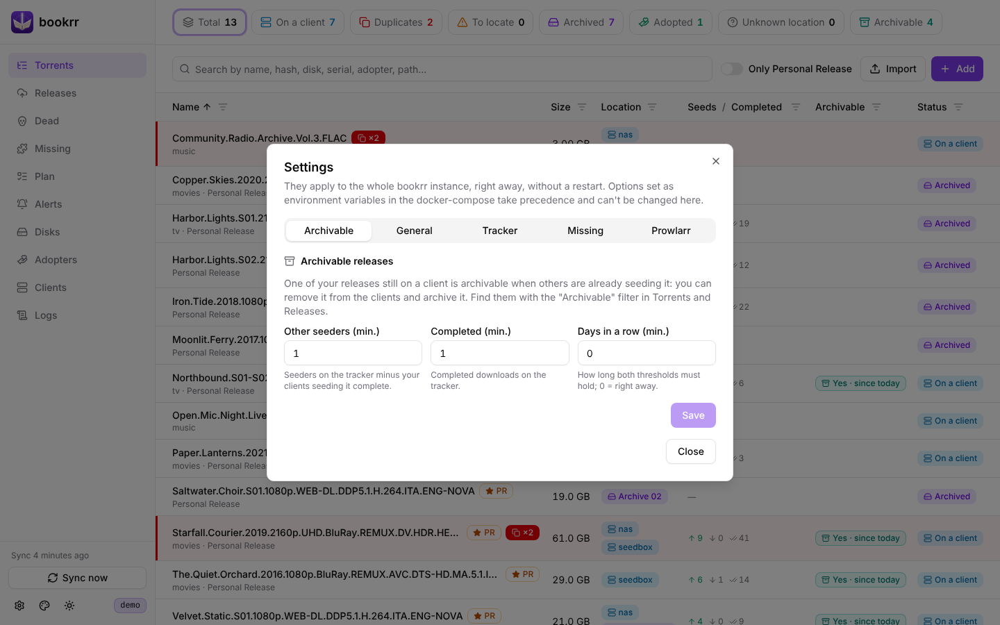

<h1 align="center">Documentazione di bookrr</h1>

> [!IMPORTANT]
> **Full Vibe Coded.** Ogni riga di bookrr, il codice, i test e questa documentazione, è stata scritta da un assistente di programmazione basato su IA, sotto la guida del proprietario. Leggi il codice prima di affidargli i tuoi dati e tieni una copia di `./data`.

<a href="../en/README.md">English</a> · <b>Italiano</b> · <a href="../../README.it.md">Torna al README</a>

Installazione e configurazione sono nel [README](../../README.it.md#installazione). L'interfaccia è in inglese: nelle guide i nomi di pagine, pulsanti e filtri sono scritti come li vedi. Le guide:

| Guida | |
|---|---|
| [Client, duplicati e segnalazioni](client-e-segnalazioni.md) | sincronizzazione, duplicati, release rimosse, spostamenti e adozioni, adottatori, webhook di rimozione |
| [Archivi](archivi.md) | dischi e QR code, dati SMART, archivi su cloud S3, import da CSV |
| [Tracker](tracker.md) | ricerca degli hash su UNIT3D, storico release, release archiviabili |
| [Risoluzione massima e piano release](prowlarr-e-piano.md) | la versione migliore che esiste dei tuoi film, con Prowlarr, e i film da rilasciare |
| [Stagioni e film mancanti](mancanti.md) | serie, saghe, collezioni, viste, qualità minima, scelte, gruppi bannati |
| [Log](log.md) | file di log e pagina Logs |
| [API](api.md) | l'API REST |
| [Sviluppo](sviluppo.md) | compilazione, test, demo e screenshot, struttura del progetto, versioni |

## L'interfaccia

Il menu a sinistra ha una pagina per ogni parte di bookrr; i contatori in cima a una pagina filtrano il suo elenco. ⚙️ in basso a sinistra apre **Settings**, 🎨 sceglie il colore del logo e dei pulsanti (il colore di una spada laser, ricordato dal browser), ☀️ il tema chiaro, scuro o di sistema.

  
  
  
  
  
  

