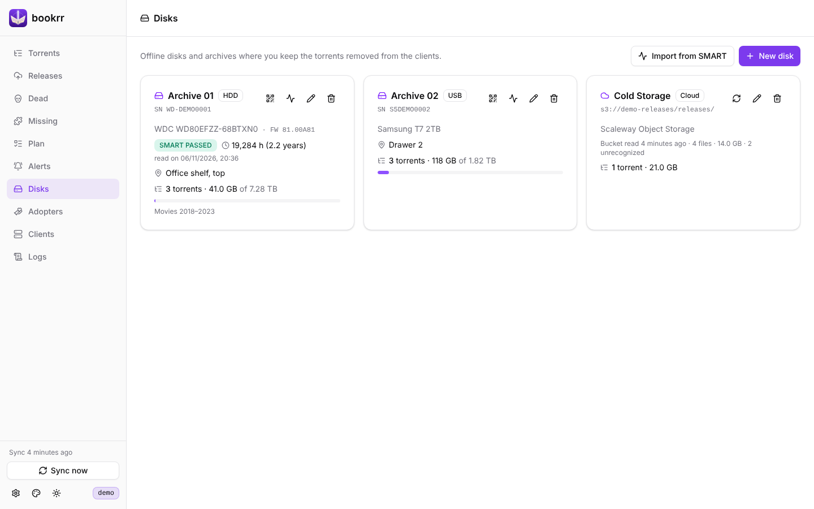
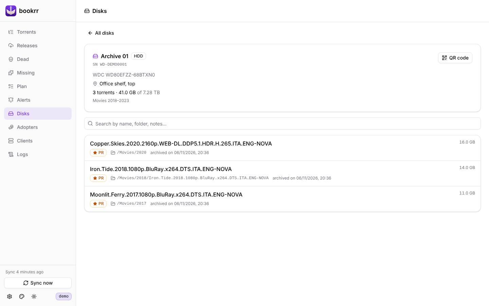
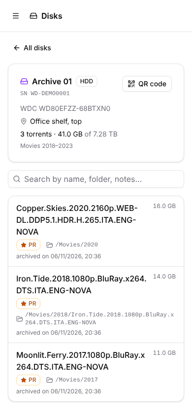
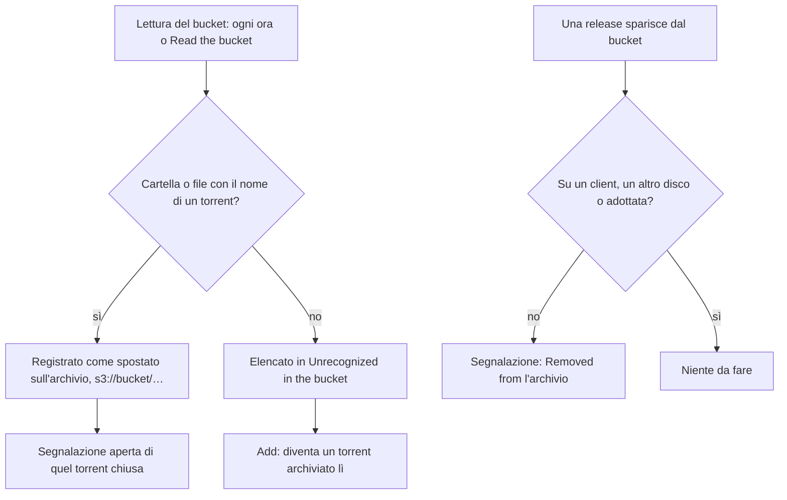

# Archivi

[Documentazione](README.md) · [English](../en/archives.md)



La pagina **Disks** contiene i dischi e gli altri archivi dove conservi i torrent tolti dai client: nome, tipo (HDD, SSD, NVMe, USB, NAS, Tape, Cloud, Other), **numero di serie**, modello, capacità, posizione e note, con quanto di ogni disco occupano i torrent archiviati. Uno spostamento si registra sul torrent con il suo disco e la cartella, dalla scheda del torrent o quando bookrr chiede dove è finita una release rimossa.

## QR code sui dischi

Ogni disco fisico ha la sua pagina con i torrent archiviati sopra, cercabili per nome, cartella e note. Dall'icona del QR stampi un'etichetta con il QR code di quella pagina: inquadrandola con il telefono vedi cosa c'è sul disco che hai in mano.

| | |
|---|---|
|  |  |

Nella finestra del QR code imposti l'**indirizzo di bookrr nella tua rete** (es. `http://192.168.1.10:8080`): quello con cui lo raggiungono gli altri dispositivi, utile se il container è in una rete Docker. Vale per tutti i dischi. Puoi scaricare il QR code in SVG o stampare un'etichetta di 50 mm.

## Dati SMART

*Import from SMART* legge il rapporto SMART di un disco e crea il disco, oppure aggiorna quello con lo stesso numero di serie (il pulsante sulla scheda di un disco aggiorna proprio quello). Formati accettati:

- `smartctl -a /dev/sdX` o `smartctl -x /dev/sdX` (SATA, NVMe, SAS);
- `smartctl -a -j /dev/sdX` (JSON);
- il testo copiato da CrystalDiskInfo (*Modifica → Copia*).

Vengono copiati modello, numero di serie, capacità, tipo (HDD/SSD/NVMe), firmware, stato SMART e ore di accensione, con la data della lettura; nome, posizione e note restano come li hai impostati, e un tipo come `USB` o `NAS` non viene sovrascritto.

Da uno script invia il rapporto così com'è:

```bash
sudo smartctl -a -j /dev/sdb | curl -X POST --data-binary @- -H "Content-Type: text/plain" \
  "http://bookrr:8080/api/disks/smart?label=Archivio%2003"
```

| Parametro | Note |
|---|---|
| `id` | aggiorna il disco con questo id invece di cercarlo per numero di serie |
| `new=1` | crea sempre un disco nuovo |
| `label` | nome del disco se viene creato (default: il modello) |
| `dryRun=1` | mostra il risultato senza salvare |

Senza `id` né `new=1` un rapporto privo di numero di serie viene rifiutato.

## Archivi su cloud S3

Un archivio di tipo **Cloud** può essere collegato a un bucket S3: in **Disks → New disk** scegli *Cloud*, attiva *Link an S3 bucket* e compila:

| Campo | Note |
|---|---|
| Service | *Scaleway Object Storage* (scegli la regione: `fr-par`, `nl-ams`, `pl-waw`) o *Other S3 service* con endpoint e regione (AWS, MinIO, Backblaze B2, Cloudflare R2, Wasabi…) |
| Bucket | solo il nome, es. `mie-release` |
| Folder | facoltativa: legge solo questa cartella del bucket (es. `releases/`) |
| Access key / Secret key | la chiave API; la secret key non viene più mostrata |

Il collegamento è in **sola lettura**: bookrr usa solo l'elenco dei file (`ListObjectsV2`), non scarica, non scrive e non cancella nulla. Usa comunque una chiave che possa solo leggere: su Scaleway crea un'applicazione IAM con il permesso **ObjectStorageReadOnly** sul progetto del bucket e genera la chiave API con quel progetto come *progetto preferito*. *Test connection* verifica la chiave leggendo la prima pagina del bucket.



Dopo il salvataggio, ogni ora (`BOOKRR_S3_SCAN_INTERVAL`) o con *Read the bucket*:

- ogni **cartella o file con lo stesso nome di un torrent** (il nome che gli dà qBittorrent), a qualunque profondità (`Film/Una.Release/` come `Una.Release/`), viene registrato come **spostato sull'archivio**, con il percorso `s3://bucket/…`; se il torrent aveva una segnalazione aperta, viene chiusa;
- se ci sposti una release prima di toglierla dal client, la rimozione non apre segnalazioni (come per gli spostamenti registrati a mano);
- se una release sparisce dal bucket e non è su nessun client, su nessun altro disco e non è adottata, si apre una segnalazione ("Removed from *nome archivio*");
- ciò che non corrisponde a nessun torrent compare nella pagina dell'archivio, in *Unrecognized in the bucket*: *Add* lo trasforma in un torrent (con il nome del bucket) archiviato lì, e con UNIT3D configurato bookrr ne cerca l'hash sul tracker.

Gli spostamenti trovati nel bucket si aggiornano da soli e non si cancellano a mano; se registri a mano lo stesso torrent sullo stesso archivio vale la tua registrazione. Cambiando bucket, endpoint o cartella, ciò che era stato trovato nel vecchio bucket viene dimenticato senza segnalazioni. Un bucket non raggiungibile non cambia nulla: l'errore compare sulla scheda dell'archivio.

## Import da CSV

In **Torrents → Import** carichi (o incolli) un file CSV con molti torrent già spostati su disco. Separatore `;`, `,` o tabulazione, prima riga con le intestazioni (c'è un modello da scaricare):

| Colonna | Note |
|---|---|
| `Name` | obbligatoria |
| `Hash` | facoltativo, 40 o 64 caratteri esadecimali |
| `Size` | `12.5 GB`, `1.5 TB`, byte… |
| `Tags` | separati da virgola |
| `Personal Release` | yes/no; se vuota vale l'interruttore nella finestra |
| `Notes` | |
| `Disk` | nome o numero di serie di un disco già registrato; se vuota vale il disco scelto nella finestra |
| `Path`, `Archive notes` | serve almeno il disco o il percorso |
| `Adopted by` | nome di un adottatore già registrato |

Vanno bene anche le intestazioni italiane dei file fatti prima (`Nome`, `Dimensione`, `Tag`, `Note`, `Disco`, `Percorso`, `Note archivio`, `Adottato da`) e `sì`/`no`.

Prima dell'import ogni riga viene verificata, anche dal server (hash già presente, ripetuto nel file…). L'import è tutto o niente: se una riga non va bene non viene scritto nulla. Il form **Add** e l'import usano lo stesso codice (`POST /api/torrents` e `POST /api/torrents/import` con gli stessi campi), quindi i dati salvati sono identici. Con un tracker configurato, i torrent importati senza hash vengono cercati sul tracker (vedi [Tracker](tracker.md#ricerca-degli-hash)).
