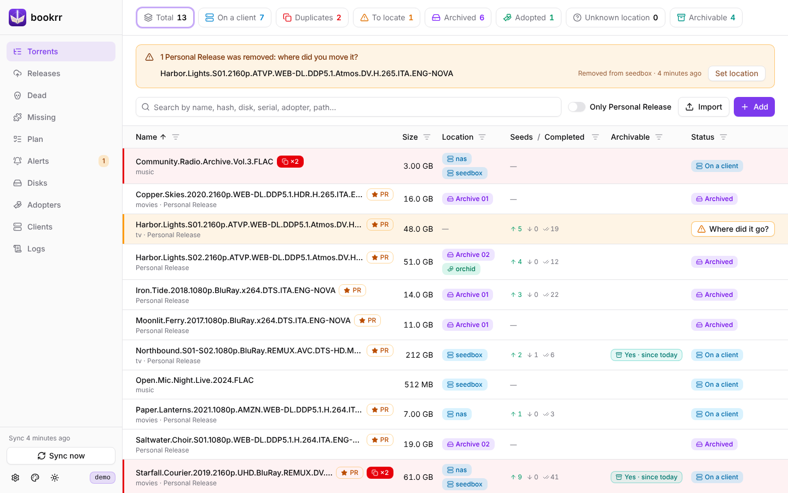
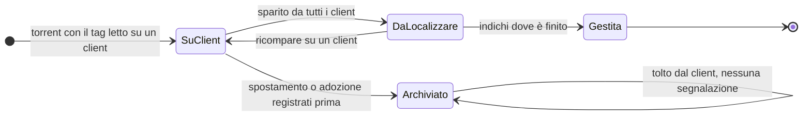
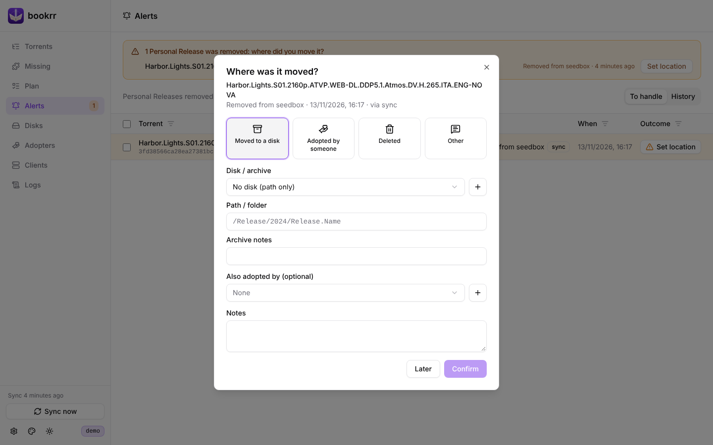
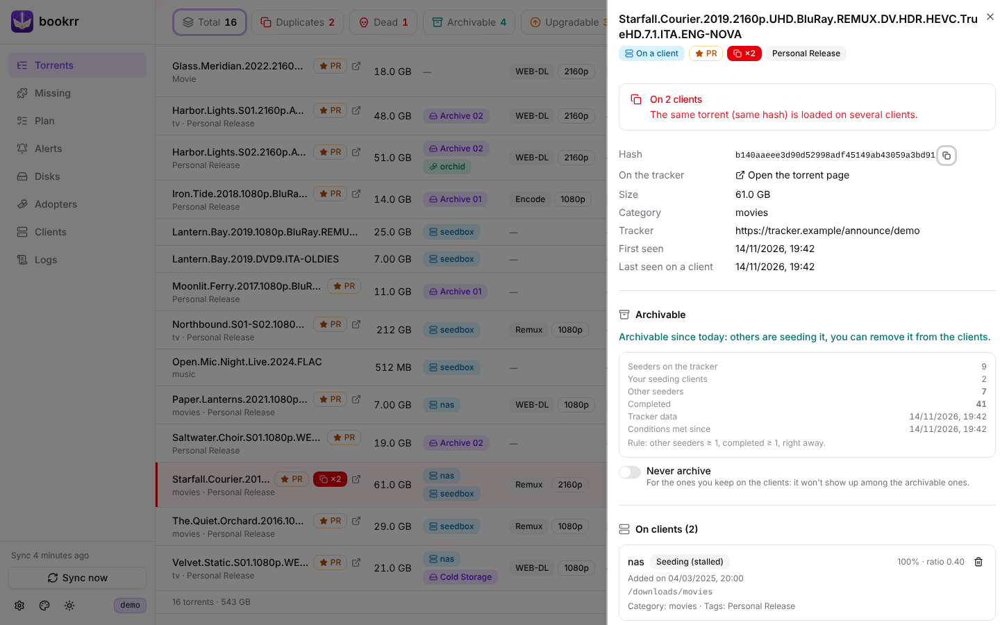

# Client, duplicati e segnalazioni

[Documentazione](README.md) · [English](../en/clients-and-alerts.md)



## Sincronizzazione

Ogni `BOOKRR_SYNC_INTERVAL` (5 minuti) bookrr legge `/api/v2/torrents/info` da ogni client attivo e lo confronta con la lettura precedente:

- un torrent presente su più client viene marcato come **duplicato**: il contatore **Duplicates** li mostra con i client dove sono ancora in download, e quando un torrent è completo ovunque puoi **toglierlo da un client**, con o senza i file (bookrr ti avvisa se l'altro client usa lo stesso percorso);
- quando un torrent con il tag delle release sparisce da **tutti** i client, bookrr apre una **segnalazione** (*To locate*) ed evidenzia la riga;
- se ricompare su un client, la segnalazione si chiude da sola;
- i torrent senza tag e senza dati tuoi (spostamenti, adozioni, note) vengono semplicemente dimenticati quando spariscono.

Un client irraggiungibile **non** genera segnalazioni: i suoi torrent restano com'erano fino alla prossima lettura riuscita. **Sync now**, in fondo al menu, legge subito i client.

Un client può avere anche un **Wayfinderr** (indirizzo e chiave API, nella sua finestra): i .torrent del piano completati su di lui vengono mandati lì, vedi [Passare il .torrent a Wayfinderr](prowlarr-e-piano.md#passare-il-torrent-a-wayfinderr).



Ogni elenco ha un filtro su ogni colonna (l'imbuto accanto al titolo): testo, intervalli di dimensione e date, client, dischi, adottatori e stati. L'interruttore **Only Personal Release** nasconde il resto.

## Spostamenti e adozioni

Registrare che un torrent è stato **spostato su un disco** o **adottato** da qualcuno risponde alla domanda "dove è finito?":

- se c'è una segnalazione aperta, viene chiusa con quella destinazione;
- nella pagina **Alerts** puoi selezionarne più di una (Maiusc+clic seleziona un intervallo) e indicare per tutte la stessa destinazione in un colpo solo;
- se lo registri mentre il torrent è ancora su un client, quando lo togli dal client non viene aperta nessuna segnalazione: finisce nello storico come già gestita.



La destinazione è una tra *Moved to a disk* (disco e cartella), *Adopted by someone*, *Deleted* o *Other* con una nota. La scheda del torrent (clic su una riga) mostra dove si trova, i dati del tracker, spostamenti e adozioni, le tue note e i tag.



## Adottatori

Nella pagina **Adopters** tieni le persone che hanno adottato le tue release e continuano a condividerle, con un contatto e delle note. Ogni torrent può avere uno o più adottatori, scelti da un menu; dalla scheda di un adottatore aggiungi torrent con un clic ciascuno.

## Webhook di rimozione

Per avere la segnalazione subito, senza aspettare la sincronizzazione, fai chiamare questo endpoint quando un torrent viene eliminato:

```
POST /api/webhook/qbit
```

Accetta JSON, form o query string. Campi:

| Campo | Obbligatorio | Note |
|---|---|---|
| `hash` | sì | info hash (anche `infohash`, `info_hash`, `hash_v1`) |
| `name` | | nome del torrent |
| `tags` | | lista separata da virgole o array JSON |
| `category`, `size` | | |
| `client` | | nome del client **come configurato in bookrr**: dice a bookrr da quale client è stato tolto |

```bash
# form
curl -X POST "http://bookrr:8080/api/webhook/qbit?token=SEGRETO" \
  -d hash="%I" -d name="%N" -d tags="%G" -d category="%L" -d client="seedbox"

# JSON
curl -X POST http://bookrr:8080/api/webhook/qbit \
  -H "Content-Type: application/json" -H "X-Bookrr-Token: SEGRETO" \
  -d '{"hash":"0123…","name":"La.Mia.Release.2024","tags":["Personal Release"],"client":"seedbox"}'
```

La segnalazione si apre solo se il torrent ha il tag delle release (nel payload o già noto a bookrr) e non è su nessun altro client. qBittorrent non ha un'opzione nativa "esegui alla rimozione": il webhook è pensato per script, qbit_manage, n8n, Home Assistant e simili. La sincronizzazione periodica rileva comunque tutte le rimozioni. La pagina **Clients** mostra il comando con il tuo indirizzo.
