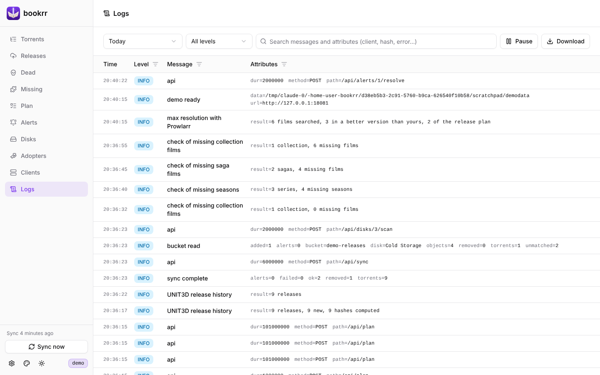

# Log

[Documentazione](README.md) · [English](../en/logs.md)



Ogni messaggio di bookrr va sullo stderr del container (`docker logs bookrr`, come sempre) e nel **file del giorno** nella cartella dati: `./data/logs/bookrr-AAAA-MM-GG.log` (data locale, vedi `TZ`), così resta dopo i riavvii e gli aggiornamenti del container. I file sono in formato [JSON Lines](https://jsonlines.org): una riga per messaggio con data e ora, livello (`DEBUG`, `INFO`, `WARN`, `ERROR`), messaggio e attributi (`err`, `client`, `hash`…), leggibili anche da fuori:

```bash
tail -f data/logs/bookrr-$(date +%F).log | jq -c '{time, level, msg}'
```

A mezzanotte bookrr passa al file nuovo; se un file supera `BOOKRR_LOG_MAX_SIZE` il giorno prosegue in `bookrr-AAAA-MM-GG.2.log`, `.3.log`… All'avvio e a ogni cambio di giorno cancella i file più vecchi di `BOOKRR_LOG_RETENTION` (30 giorni). Conservazione, dimensione e livello si cambiano anche da **Settings → General** e si applicano subito. I messaggi scritti prima che la cartella dati sia pronta (errori di configurazione o della cartella stessa) vanno solo sullo stderr. Le chiavi API e le password non finiscono mai nei log.

La pagina **Logs** mostra i messaggi di un giorno (di default oggi), dal più recente: ora, livello, messaggio e attributi, con il filtro su ogni colonna, il **livello minimo** e la **ricerca** nel testo (fatti dal server, su tutto il file). Sul giorno corrente la pagina si aggiorna da sola ogni 5 secondi con le righe nuove (**Pause** la ferma); **Download** scarica il file del giorno così com'è. Se un giorno ha più di 5000 messaggi che corrispondono alla ricerca, la pagina mostra gli ultimi.

API: `GET /api/logs/files` (i file: nome, giorno, dimensione), `GET /api/logs?day=AAAA-MM-GG&level=warn&q=testo` (le righe del giorno, filtrate; risponde con `next`: con `&after=<next>` legge solo le righe aggiunte da allora), `GET /api/logs/files/{nome}` (scarica il file). Sono protette dallo stesso login del resto dell'API.
