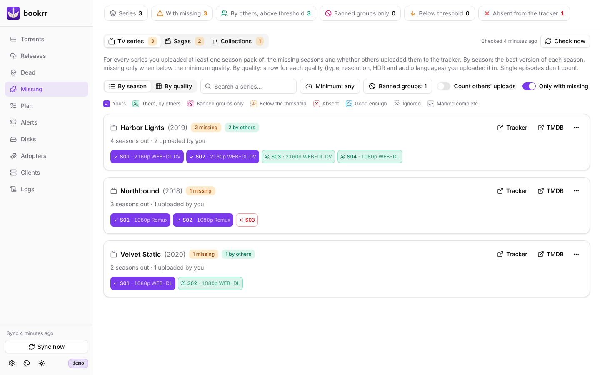
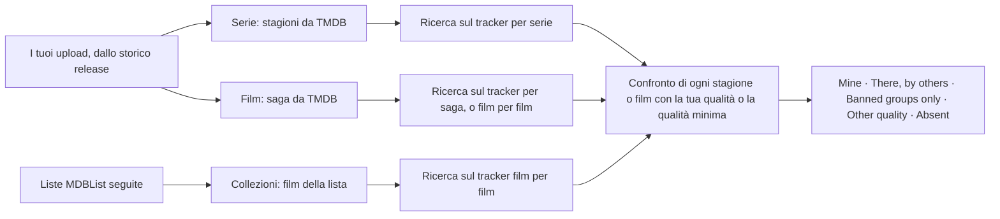
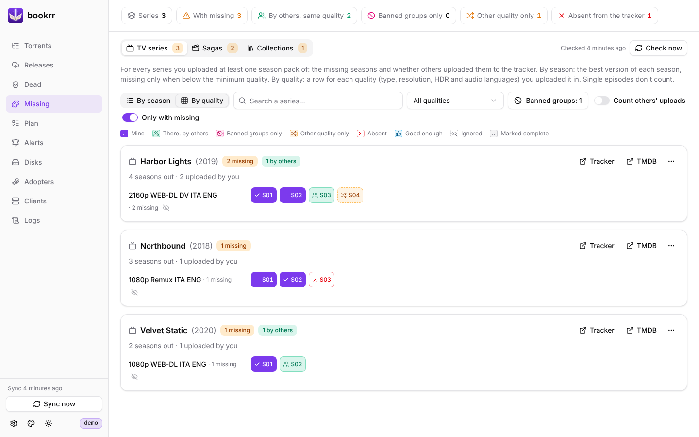
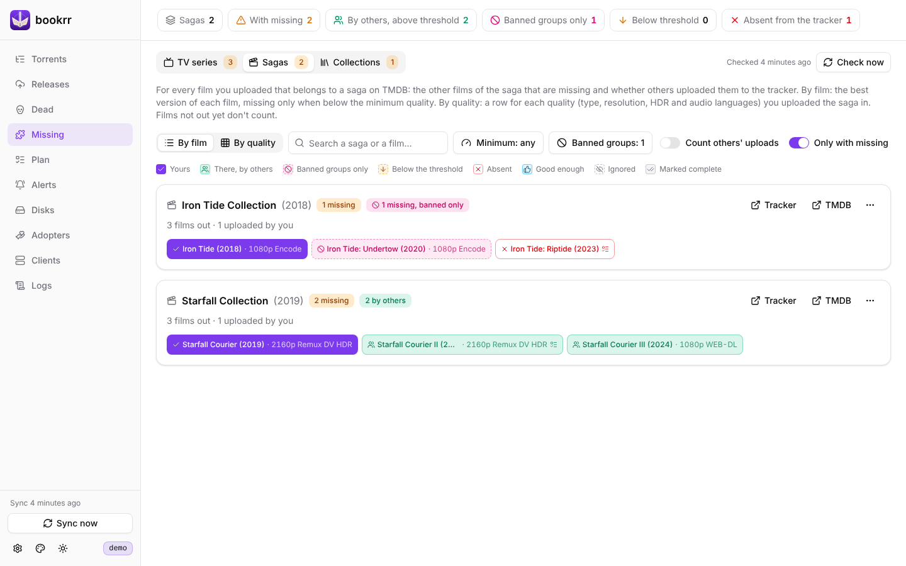
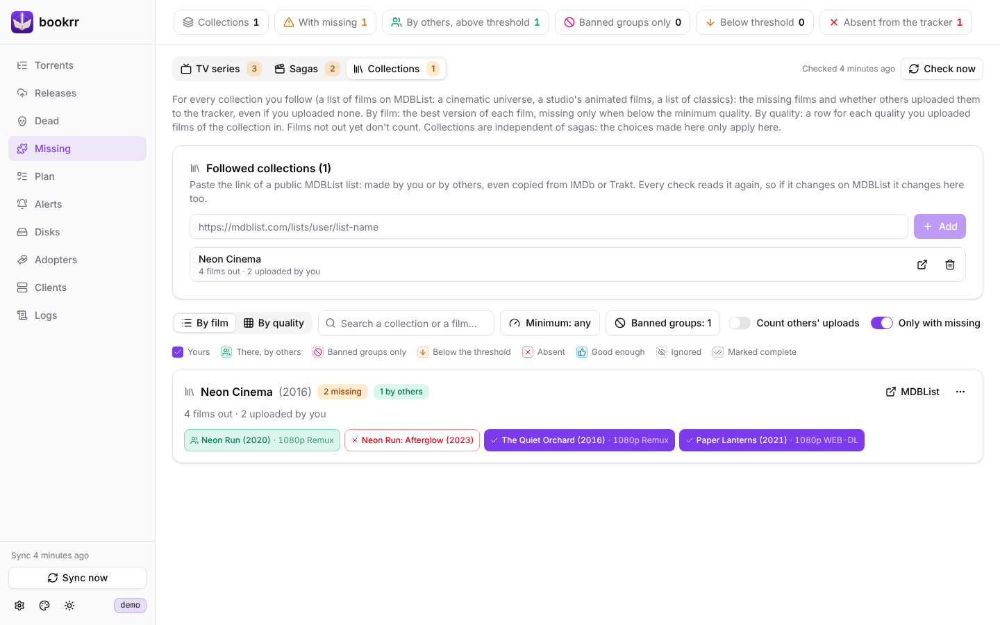

# Stagioni e film mancanti

[Documentazione](README.md) · [English](../en/missing.md)

Con il tracker UNIT3D e `BOOKRR_TMDB_API_KEY` configurati, la pagina **Missing** ti dice, nella scheda **TV series**, per ogni serie di cui hai caricato almeno una stagione, **quali stagioni mancano** nella tua qualità e se sul tracker le hanno già caricate altri; la scheda **Sagas** fa lo stesso per i **film delle saghe** e la scheda **Collections** per le liste di film che segui su MDBList. Senza una delle due chiavi la pagina è disattivata e spiega cosa manca.

## Serie TV

- contano solo i **season pack** (`S03`, `Stagione 3`) e i **pack di più stagioni o della serie intera** (`S01-S05`, `S01-05`, `S01.S02.S03`, `Season 1-3`, `Stagioni 1 e 2`, `Complete`); gli **episodi singoli** (`S01E01`, `S01E01-E10`) si ignorano, tuoi e degli altri. Un pack `Complete` senza numeri di stagione vale per le stagioni già uscite quando è stato caricato;
- **stessa qualità** = stesso tipo (WEB-DL, Remux, Encode… come lo indica il tracker) + stessa risoluzione + stesso insieme di formati HDR (DV, HDR, HLG) + stesse lingue audio. Quindi `2160p WEB-DL DV HDR ITA ENG` è diverso da `2160p WEB-DL DV HDR ITA` e da `2160p WEB-DL HDR ITA ENG`. HDR e lingue si leggono dal nome; se il nome non indica le lingue (o dice solo `MULTI`) si usano le tracce audio del *media info* del torrent;
- le **stagioni della serie** vengono da TMDB (`GET /tv/{id}`), senza gli speciali (stagione 0) e le stagioni non ancora uscite. Se sul tracker la release non ha l'id TMDB, bookrr lo cerca dall'id TVDB (`GET /find/{id}`); se non ci riesce la serie compare tra quelle **che non si possono verificare**;
- sul tracker bookrr fa **una ricerca per serie** (`GET /api/torrents/filter?tmdbId=…`, tutte le pagine, con le stesse precauzioni dello storico: al massimo una richiesta ogni 2,5 secondi e il parametro che evita la cache condivisa). TMDB numera film e serie separatamente, quindi contano solo i torrent nelle categorie dei tuoi upload della serie. Il numero di stagione si ricava dal nome.

Nella vista per qualità ogni serie ha una riga per ognuna delle tue qualità e ogni stagione è:

| Stato | Significato |
|---|---|
| **Mine** | l'hai caricata tu in questa qualità |
| **There, by others** | caricata da altri nella stessa qualità |
| **Banned groups only** | caricata da altri nella stessa qualità, ma solo da [gruppi bannati](#gruppi-bannati) |
| **Other quality only** | sul tracker c'è, ma solo in altre qualità (elencate nel dettaglio) |
| **Absent** | non c'è sul tracker in nessuna qualità |

Cliccando una stagione si aprono i torrent trovati, con il link alla loro pagina sul tracker. Ogni serie mostra il numero di stagioni mancanti (la somma sulle tue qualità) e i link alla serie sul tracker e su TMDB; puoi cercare per nome, filtrare per qualità e mostrare **solo le serie con mancanti**.

## Saghe

Per ogni film che hai caricato e che su TMDB fa parte di una **saga** (una *collection*, come la "Starfall Collection" degli screenshot), la scheda **Sagas** mostra gli altri film della saga nella stessa qualità, con gli stessi stati delle stagioni:

- contano solo le release della **categoria film** (una categoria del tracker che contiene `Movie` o `Film`; senza categoria, un nome senza stagioni né episodi e senza id TVDB): l'id TMDB di un film non è quello di una serie;
- la saga del film viene da TMDB (`GET /movie/{id}`, campo `belongs_to_collection`); i film senza saga non compaiono. Se la release non ha l'id TMDB, bookrr lo cerca dall'id IMDb (`GET /find/tt…`); se non ci riesce il film compare tra quelli **che non si possono verificare**;
- i **film della saga** vengono da TMDB (`GET /collection/{id}`), in ordine di uscita, **senza quelli non ancora usciti** (o senza data), tranne quelli che hai caricato tu;
- sul tracker bookrr fa **una ricerca per saga** (`GET /api/torrents/filter?collectionId=…`). Se non restituisce nulla, o restituisce film che non sono della saga (un tracker che non conosce il filtro), cerca **film per film** (`tmdbId=…`). Contano solo i torrent nelle categorie film; **stessa qualità** ha la stessa definizione delle serie.

Nelle celle il titolo del film è scritto senza la parte comune a tutta la saga; cliccando si aprono i torrent trovati e il link al film su TMDB. Si può cercare per nome della saga o di un film.

## Collezioni

Una saga di TMDB è un film e i suoi seguiti; un universo cinematografico, i film d'animazione di uno studio o una lista di classici non sono saghe. Per questi c'è la scheda **Collections**: con `BOOKRR_MDBLIST_API_KEY` incolli il link di una lista pubblica di [MDBList](https://mdblist.com) (es. `https://mdblist.com/lists/utente/nome-lista`, anche una lista di IMDb o Trakt copiata su MDBList) e bookrr la segue:

- i film della collezione sono quelli della lista **nell'ordine della lista**, letti a ogni controllo (`GET /lists/{utente}/{lista}/items/movie`), quindi se la lista cambia cambia anche la collezione; titolo e data di uscita vengono da TMDB, e un film senza id TMDB si cerca dall'id IMDb. I film **non ancora usciti** non contano, tranne quelli che hai caricato tu;
- una collezione si vede sempre, **anche se non hai caricato nessuno dei suoi film**: nella vista per film ogni film è tuo, di altri, sotto la soglia o assente; la vista per qualità ha una riga per ogni qualità in cui hai caricato almeno un suo film;
- il tracker non conosce le liste: bookrr cerca **film per film** (`tmdbId=…`), una volta sola per film anche se è in più collezioni;
- le collezioni sono **indipendenti dalle saghe**: un film può stare sia in una saga sia in una collezione, e le scelte (accettata, ignorata, completa, nascosta, qualità minima) fatte in una non valgono nell'altra;
- una lista cancellata o resa privata su MDBList compare tra le **liste non trovate**. **Stop following** (il cestino accanto alla collezione) toglie la collezione con i suoi risultati e le scelte fatte sui suoi film; la lista su MDBList non viene toccata.

Una collezione nuova viene controllata subito; le altre si aggiornano con il controllo notturno. MDBList gratuito permette 1000 richieste al giorno: bookrr ne usa una per collezione a ogni controllo (più una quando la aggiungi).

## Vista per stagione / per film e qualità minima

La griglia per qualità diventa difficile da leggere quando hai caricato una saga in più qualità «massime» (il primo film in 2160p Remux DV, il secondo che esiste solo in 1080p Remux): il secondo risulta mancante in tutte le righe 2160p. Per questo ogni scheda ha due viste, e il browser ricorda l'ultima scelta (la prima volta è quella per parte):

- **By season / By film**: una riga per serie o saga, una cella per stagione o film con la sua **versione migliore** (la tua, se ne hai una che raggiunge la qualità minima; altrimenti la migliore degli altri che la raggiunge; altrimenti la migliore in assoluto). «Migliore» vuol dire, in ordine: tipo (Full Disc > Remux > Encode > WEB-DL > WEBRip > HDTV), risoluzione, HDR (DV vale più degli altri), numero di lingue audio;
- **By quality**: la griglia descritta sopra, una riga per ogni tua qualità.

La **qualità minima** (il pulsante *Minimum*, una per le serie, una per le saghe e una per le collezioni; ognuna può averne una propria dal menu ⋯) è fatta di tipo minimo, risoluzione minima e lingua audio richiesta, ognuno facoltativo. Una parte è **Yours** se l'hai caricata almeno in quella qualità, **There, by others** se l'ha fatto qualcun altro, **Below the threshold** se sul tracker c'è solo in qualità inferiori, **Absent** se non c'è. Le release di cui non si conoscono le lingue (o solo `MULTI`) contano come se avessero quella richiesta. Esempio: con minima *Encode* un 1080p Encode di altri va bene; con minima *Remux* è sotto la soglia.

Le tue scelte restano anche dopo i controlli successivi:

| Scelta | Dove | Effetto |
|---|---|---|
| **Count others' uploads** | interruttore sopra la lista | quello che hanno caricato altri (nella stessa qualità, o sopra la soglia) non conta come mancante |
| **This one is fine** | dettaglio di una cella, su una release di altri | la cella diventa *Good enough* e non conta come mancante; se il torrent sparisce dal tracker torna mancante |
| **Ignore** | dettaglio di una cella | la cella non conta come mancante (es. «non esiste in 4K») |
| **Mark as complete** | menu ⋯ della serie o saga | le parti uscite finora non contano come mancanti; una stagione o un film usciti dopo sì |
| **Hide** | menu ⋯ (serie o saga), icona accanto a una qualità | sparisce dai numeri e dalla lista; si ripristina da *Hidden* o dal link sotto la griglia |
| **Add the missing ones to the plan** | menu ⋯ di una saga o collezione | i film mancanti vanno nel [piano release](prowlarr-e-piano.md#piano-release) |

*This one is fine* e *Ignore* dalla vista per parte valgono per tutte le qualità; dalla vista per qualità solo per quella riga.

## Gruppi bannati

Il **release group** è quello dopo l'ultimo `-` del nome (`…H.265-NOVA` → `NOVA`) e compare accanto a ogni torrent nel dettaglio di una cella. Con **Banned groups** (sopra la lista, oppure l'icona del divieto accanto a una release di altri) indichi i gruppi le cui release non ti bastano; la lista è una sola per serie, saghe e collezioni e le maiuscole non contano. Se una stagione o un film c'è sul tracker **solo** da gruppi bannati:

- resta **mancante**, anche con *Count others' uploads*, ma è **rosa** (*Banned groups only*) invece che verde, per dargli meno priorità;
- nella vista per parte una release di un gruppo bannato vale solo se non ce n'è una di altri gruppi che raggiunge la qualità minima;
- il conteggio dei mancanti della serie o saga e il numero sulla scheda non lo contano: è mostrato a parte («N missing, banned only»), e le serie o saghe a cui manca solo questo vanno in fondo alla lista.

Le tue release non contano mai come bannate. Un torrent accettato con *This one is fine* resta accettato anche se il suo gruppo è bannato.

## Quando gira

Il controllo, serie, saghe e collezioni insieme, gira **ogni notte** alle `BOOKRR_MISSING_CHECK_AT` (04:00), con **Check now** e, se l'ultimo ha più di un giorno (bookrr era spento), 10 minuti dopo l'avvio. Usa i tuoi upload letti dallo storico release; i risultati restano nel database con la data dell'ultimo controllo, e un controllo non riuscito lascia quelli precedenti (se fallisce solo una delle parti, le altre vengono comunque aggiornate).

I risultati di un controllo fatto con una versione precedente non hanno le versioni delle singole parti: fino al controllo successivo (che parte da solo 10 minuti dopo l'avvio) la vista per parte li mostra per qualità.

API: `GET /api/missing/series`, `GET /api/missing/sagas`, `GET /api/missing/lists` (con le collezioni seguite in `sources`), `POST /api/missing/check`, `PUT /api/missing/{series|sagas|lists}/prefs` (qualità minima e «conta quelle di altri»), `POST`/`DELETE /api/missing/{series|sagas|lists}/marks` (le scelte: `hide`, `complete`, `accept`, `ignore`, `threshold`), `PUT /api/missing/banned-groups` con `{"groups": ["GRUPPO"]}`, `POST /api/missing/lists/sources` con `{"url": "https://mdblist.com/lists/…"}` (segui una collezione) e `DELETE /api/missing/lists/sources/{id}`.
