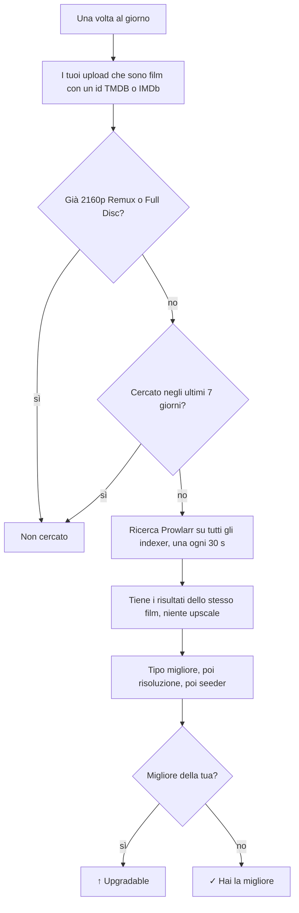

# Risoluzione massima e piano release

[Documentazione](README.md) · [English](../en/prowlarr-and-plan.md)

## Risoluzione massima

Con `BOOKRR_PROWLARR_URL` e `BOOKRR_PROWLARR_API_KEY` (e il tracker UNIT3D, da cui vengono i film) la pagina **Releases** ha la colonna **Max**: la versione migliore che esiste di ogni film che hai caricato, **in qualsiasi lingua** (l'audio nella tua lingua lo aggiungi tu con un mux). «Migliore» vuol dire prima il **tipo** (Remux > Encode > WEB-DL > WEBRip > HDTV; un Full Disc conta come un Remux), poi la **risoluzione**: un 1080p Remux batte un 2160p WEB-DL. Mostra:

- **↑ 2160p Remux** (in giallo): il film esiste in una versione migliore della tua migliore release di quel film (un tipo migliore, o lo stesso tipo in una risoluzione più alta); il tooltip dice quale release e su quale indexer, e con un clic si apre la sua pagina. Il contatore **Upgradable** in alto filtra questi film;
- **✓**: hai già la versione migliore che esiste (i film che hai già in 2160p Remux o Full Disc non vengono cercati);
- **Not found**: Prowlarr non ha trovato release del film con una risoluzione nota;
- **—**: non è un film (le serie non vengono cercate) o non è ancora stato cercato.

1. una volta al giorno (la prima 15 minuti dopo l'avvio) bookrr prende i tuoi upload sul tracker che sono **film** con un id TMDB o IMDb, tranne quelli che hai già in 2160p Remux o Full Disc, e cerca quelli mai cercati o cercati più di `BOOKRR_PROWLARR_RECHECK` fa (7 giorni);
2. per ogni film chiede a Prowlarr `GET /api/v1/search?type=movie&query={ImdbId:tt…}{TmdbId:…}` nella categoria Film (2000): Prowlarr lo cerca su **tutti i tuoi indexer**. Le ricerche sono lente apposta: una alla volta, a 30 secondi l'una dall'altra, per non pesare sui tracker (i limiti che hai impostato in Prowlarr per ogni indexer valgono comunque);
3. contano solo i risultati di quel film: con lo stesso id TMDB o IMDb oppure, se l'indexer non li indica, con lo stesso titolo e anno (±1) di una tua release. Gli **upscale** non contano. Tipo e risoluzione sono letti dal nome della release (`REMUX`, `WEB-DL`, `WEBRip`, `BluRay` = Encode, `HDTV`); vince il tipo migliore, poi la risoluzione più alta, poi la più seminata. I tuoi film sono confrontati con il tipo indicato dal tracker.

Se Prowlarr non risponde o rifiuta la chiave, la ricerca si ferma (l'errore compare in cima alla pagina) e i film rimasti vengono cercati il giorno dopo.

## Piano release

La pagina **Plan** è la lista dei film che vuoi rilasciare. Li aggiungi con **Add film** dal loro id TMDB, dal link su themoviedb.org o dall'id IMDb (serve `BOOKRR_TMDB_API_KEY`), oppure da **Missing**: il singolo film di una saga o collezione, o tutti i mancanti in un colpo dal menu ⋯ della saga.

Per ogni film bookrr mostra:

- la **versione migliore** che esiste, cercata con Prowlarr quando lo aggiungi e poi ogni `BOOKRR_PROWLARR_RECHECK` insieme alla ricerca giornaliera della risoluzione massima; il badge è giallo quando è migliore di quanto hai già caricato di quel film. I film non ancora usciti mostrano la data di uscita e vengono cercati quando escono;
- cosa c'è **sul tracker**: i tuoi upload del film e i torrent degli altri, con la loro qualità;
- il suo **stato**: *To do*, *In progress*, *Done* o *Dropped*, e una nota facoltativa (da dove prendere l'audio, i sottotitoli…).

Quando carichi il film sul tracker, la lettura successiva dello storico release lo segna **Done** da sola. *Dropped* lo tiene nel piano senza cercarlo più. I contatori in alto filtrano i film da rilasciare, quelli trovati in una versione migliore, in corso, fatti o tutti.

API: `GET /api/plan`, `GET /api/plan/lookup?q=…`, `POST /api/plan` con `{"tmdb": "603", "note": "…"}`, `POST /api/plan/bulk` con `{"tmdbIds": […]}`, `PATCH /api/plan/{id}` con `{"status": "doing", "note": "…"}`, `POST /api/plan/{id}/search`, `DELETE /api/plan/{id}`.
