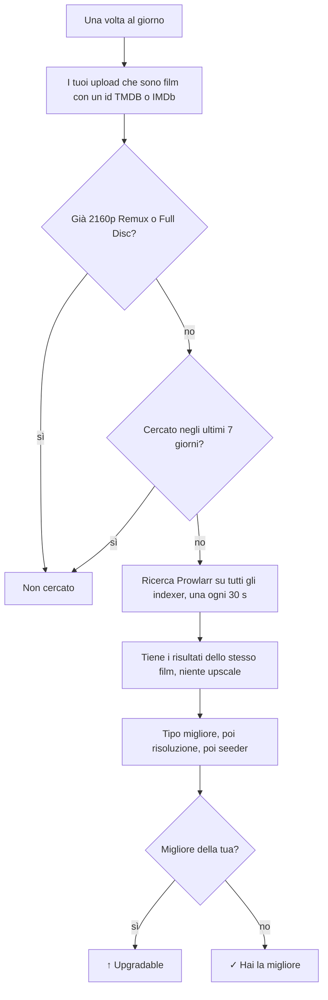
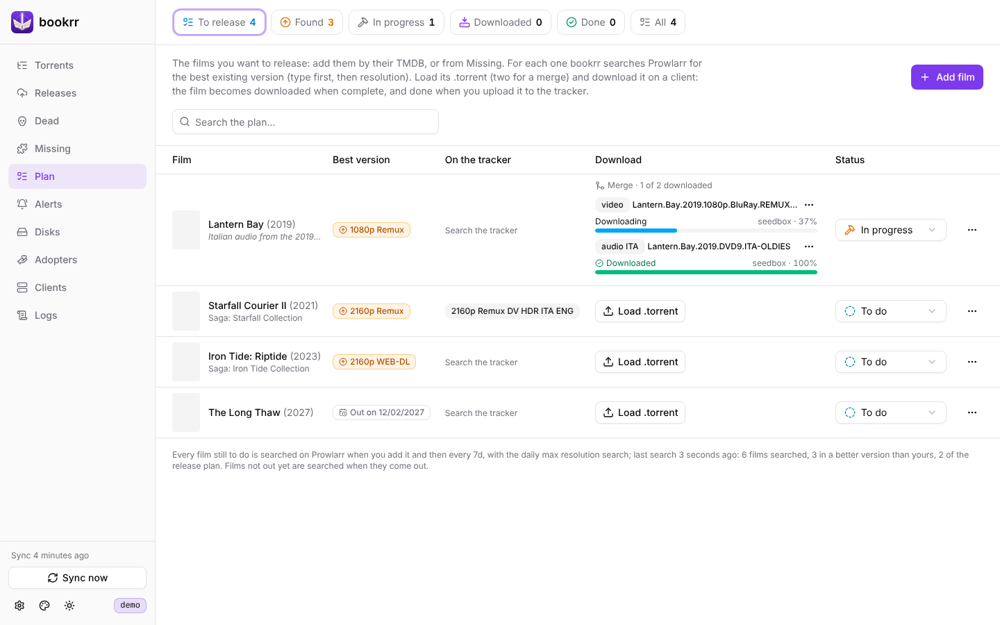

# Risoluzione massima e piano release

[Documentazione](README.md) · [English](../en/prowlarr-and-plan.md)

## Risoluzione massima

Con `BOOKRR_PROWLARR_URL` e `BOOKRR_PROWLARR_API_KEY` (e il tracker UNIT3D, da cui vengono i film) la pagina **Releases** ha la colonna **Max**: la versione migliore che esiste di ogni film che hai caricato, **in qualsiasi lingua** (l'audio nella tua lingua lo aggiungi tu con un mux). «Migliore» vuol dire prima il **tipo** (Remux > Encode > WEB-DL > WEBRip > HDTV; un Full Disc conta come un Remux), poi la **risoluzione**: un 1080p Remux batte un 2160p WEB-DL. Mostra:

- **↑ 2160p Remux** (in giallo): il film esiste in una versione migliore della tua migliore release di quel film (un tipo migliore, o lo stesso tipo in una risoluzione più alta); il tooltip dice quale release e su quale indexer, e con un clic si apre la sua pagina. Il contatore **Upgradable** in alto filtra questi film;
- **✓**: hai già la versione migliore che esiste (i film che hai già in 2160p Remux o Full Disc non vengono cercati);
- **Not found**: Prowlarr non ha trovato release del film con una risoluzione nota;
- **—**: non è un film (le serie non vengono cercate) o non è ancora stato cercato.

1. una volta al giorno (la prima 15 minuti dopo l'avvio) bookrr prende i tuoi upload sul tracker che sono **film** con un id TMDB o IMDb, tranne quelli che hai già in 2160p Remux o Full Disc, e cerca quelli mai cercati o cercati più di `BOOKRR_PROWLARR_RECHECK` fa (7 giorni);
2. per ogni film chiede a Prowlarr `GET /api/v1/search?type=movie&query={ImdbId:tt…}{TmdbId:…}` nella categoria Film (2000): Prowlarr lo cerca su **tutti i tuoi indexer**. Le ricerche sono lente apposta: una alla volta, a 30 secondi l'una dall'altra, per non pesare sui tracker (i limiti che hai impostato in Prowlarr per ogni indexer valgono comunque);
3. contano solo i risultati di quel film: con lo stesso id TMDB o IMDb oppure, se l'indexer non li indica, con lo stesso titolo e anno (±1) di una tua release. Gli **upscale** non contano. Tipo e risoluzione sono letti dal nome della release (`REMUX`, `WEB-DL`, `WEBRip`, `BluRay` = Encode, `HDTV`); vince il tipo migliore, poi la risoluzione più alta, poi la più seminata. I tuoi film sono confrontati con il tipo indicato dal tracker.

Se Prowlarr non risponde o rifiuta la chiave, la ricerca si ferma (l'errore compare in cima alla pagina) e i film rimasti vengono cercati il giorno dopo.

## Piano release

La pagina **Plan** è la lista dei film che vuoi rilasciare. Li aggiungi con **Add film** dal loro id TMDB, dal link su themoviedb.org o dall'id IMDb (serve `BOOKRR_TMDB_API_KEY`), oppure da **Missing**: il singolo film di una saga o collezione, o tutti i mancanti in un colpo dal menu ⋯ della saga.

Per ogni film bookrr mostra:

- la **versione migliore** che esiste, cercata con Prowlarr quando lo aggiungi e poi ogni `BOOKRR_PROWLARR_RECHECK` insieme alla ricerca giornaliera della risoluzione massima; il badge è giallo quando è migliore di quanto hai già caricato di quel film. I film non ancora usciti mostrano la data di uscita e vengono cercati quando escono;
- cosa c'è **sul tracker**: i tuoi upload del film e i torrent degli altri, con la loro qualità;
- il suo **download**: i file .torrent che hai caricato e come vanno sui client (vedi sotto);
- il suo **stato**: *To do*, *In progress*, *Downloaded*, *Done* o *Dropped*, e una nota facoltativa (da dove prendere l'audio, i sottotitoli…).

Quando carichi il film sul tracker, la lettura successiva dello storico release (ogni `BOOKRR_UNIT3D_RELEASES_INTERVAL`) lo segna **Done** da sola, anche quando era *Downloaded*. *Dropped* lo tiene nel piano senza cercarlo più. I contatori in alto filtrano i film da rilasciare, quelli trovati in una versione migliore, in corso, scaricati, fatti o tutti.

### Scaricare la sorgente

Con **Load .torrent** carichi su un film il file .torrent della sua sorgente: bookrr lo tiene, anche dopo averlo inviato, così puoi rimandarlo. Quando la release è un **merge** di due sorgenti (il video da una, l'audio o i sottotitoli dall'altra) ne carichi un secondo con **Second .torrent (merge)**; ognuno può avere un'etichetta (*video*, *audio ITA*) per ricordare cosa prenderne. Dal menu ⋯ di ogni torrent lo sostituisci, ne cambi l'etichetta, salvi il file o lo togli dal film (non dai client).

**Download** manda i torrent non ancora su un client a uno dei tuoi client qBittorrent:

- di base chiede quale, con **Advanced** per categoria, tag e percorso (vuoti, i default del client);
- con un **client predefinito** (Settings → Plan) li manda lì senza chiedere; *Send to a client…* nel menu ⋯ di un torrent permette comunque di sceglierne un altro, e le opzioni avanzate.

Il film passa *In progress* e la sua riga mostra, per ogni torrent, il client, lo stato e l'avanzamento, letti con i client ogni `BOOKRR_SYNC_INTERVAL` (e subito dopo l'invio). Quando tutti i torrent del film sono completi diventa **Downloaded** da solo; con un merge, finché non sono completi entrambi mostra "1 of 2 downloaded". Se lo rimetti a mano a *To do* o *In progress* resta lì, finché non rimandi i suoi torrent. Un torrent tolto dal client dopo l'invio viene segnalato, e *Download* può rimandarlo.

API: `GET /api/plan`, `GET /api/plan/lookup?q=…`, `POST /api/plan` con `{"tmdb": "603", "note": "…"}`, `POST /api/plan/bulk` con `{"tmdbIds": […]}`, `PATCH /api/plan/{id}` con `{"status": "doing", "note": "…"}`, `POST /api/plan/{id}/search`, `DELETE /api/plan/{id}`. I file .torrent di un film: `POST /api/plan/{id}/torrents` (form con `file` e `label` facoltativa; alla prima posizione libera, due al massimo), `PUT /api/plan/{id}/torrents/{position}` (lo sostituisce, stesso form), `PATCH /api/plan/{id}/torrents/{position}` con `{"label": "…"}`, `DELETE /api/plan/{id}/torrents/{position}`, `GET /api/plan/{id}/torrents/{position}/file`, e `POST /api/plan/{id}/torrents/send` con `{"clientId": 1, "positions": [1], "category": "", "tags": "", "savePath": ""}` (tutto facoltativo: senza client è quello predefinito, senza posizioni sono tutti). Il client predefinito è `planClientId` di `PUT /api/settings` (0 chiede ogni volta).
