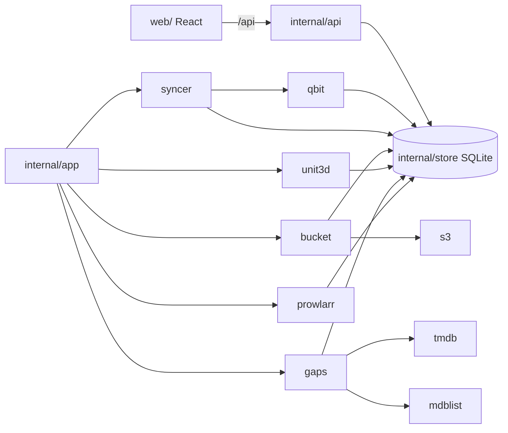

# Sviluppo

[Documentazione](README.md) · [English](../en/development.md)

Requisiti: Go 1.24+, Node 22+.

```bash
# backend (crea ./data/bookrr.db)
BOOKRR_DATA_DIR=./data BOOKRR_LISTEN=:8080 go run ./cmd/bookrr

# frontend con hot reload su http://localhost:5173 (proxy verso :8080)
cd web && npm install && npm run dev

# build completa: il frontend viene incorporato nel binario
cd web && npm run build && cd .. && go build -o bookrr ./cmd/bookrr

# test e controllo dei tipi
go test ./...
cd web && npm run lint
```

## Demo e screenshot

`scripts/demo` avvia bookrr con dati inventati: due client qBittorrent, un tracker UNIT3D, TMDB, MDBList, Prowlarr e un bucket S3 sono simulati nello stesso processo, e i dati vengono inseriti attraverso l'API di bookrr. Ogni titolo, release group e utente è inventato. È così che sono fatti gli screenshot di questa documentazione:

```bash
cd web && npm run build && cd ..
go run ./scripts/demo -listen 127.0.0.1:8080       # aspetta le ricerche finte, poi scrive "demo ready"
node scripts/demo/screenshots.mjs http://127.0.0.1:8080   # scrive docs/screenshots/*.png
```

Lo script degli screenshot richiede [Playwright](https://playwright.dev) con Chromium (`npm i -g playwright && npx playwright install chromium`). Il demo usa ogni volta una nuova cartella dati temporanea (`-data` per sceglierla).

## Struttura del progetto

| Cartella | Cosa fa |
|---|---|
| `cmd/bookrr` | punto di ingresso: configurazione, database, servizi, server web |
| `internal/api` | API REST, webhook, file statici |
| `internal/app` | avvia e riavvia i servizi in background quando cambia la configurazione |
| `internal/config` | variabili d'ambiente e opzioni delle Settings |
| `internal/store` | database SQLite (modernc.org/sqlite, puro Go, niente CGO) e sue migrazioni |
| `internal/syncer` | lettura periodica dei client qBittorrent |
| `internal/qbit` | client minimale della Web API di qBittorrent |
| `internal/bucket`, `internal/s3` | client S3 in sola lettura (ListObjectsV2, SigV4) e letture degli archivi cloud |
| `internal/smart` | rapporti SMART (smartctl, CrystalDiskInfo) |
| `internal/unit3d` | tracker UNIT3D: ricerca degli hash, storico release, nomi e qualità delle release |
| `internal/gaps` | stagioni mancanti, film delle saghe e delle collezioni |
| `internal/tmdb`, `internal/mdblist` | client minimali di The Movie Database e MDBList |
| `internal/prowlarr` | ricerche con Prowlarr: risoluzione massima e piano release |
| `internal/logs` | file di log, uno al giorno |
| `web/` | frontend React + Vite + Tailwind + shadcn/ui |
| `scripts/demo` | il demo e gli screenshot |



Il logo e i suoi colori sono definiti in `web/src/lib/accent.ts`; dopo averli cambiati, `cd web && npm run logos` rigenera `docs/logo/` e `web/public/favicon.svg`.

## Versioni e rilasci

La versione sta in `VERSION` ed è mostrata in fondo al menu. Quando una pull request viene unita in `main`, la CI pubblica le immagini `X.Y.Z` e `X.Y` e crea il tag `vX.Y.Z`. Ogni pull request che cambia ciò che gli utenti eseguono aumenta `VERSION`: patch per correzioni e piccole modifiche, minor per le funzioni nuove (e, finché si è sulla 0.x, per i cambiamenti incompatibili). Le modifiche solo alla documentazione, alla CI o ai test non cambiano versione.

Il workflow *Cleanup branches* cancella il branch di una pull request appena viene unita e, ogni settimana, i branch la cui pull request è stata unita all'ultimo commit o che non hanno più nulla che non sia già in `main`; i branch con una pull request aperta o con commit più recenti restano. Lancialo a mano dalla scheda Actions con *dry run* per vedere cosa cancellerebbe.
