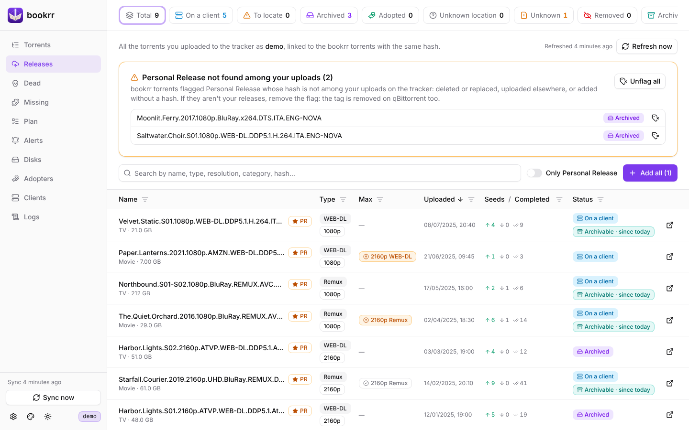
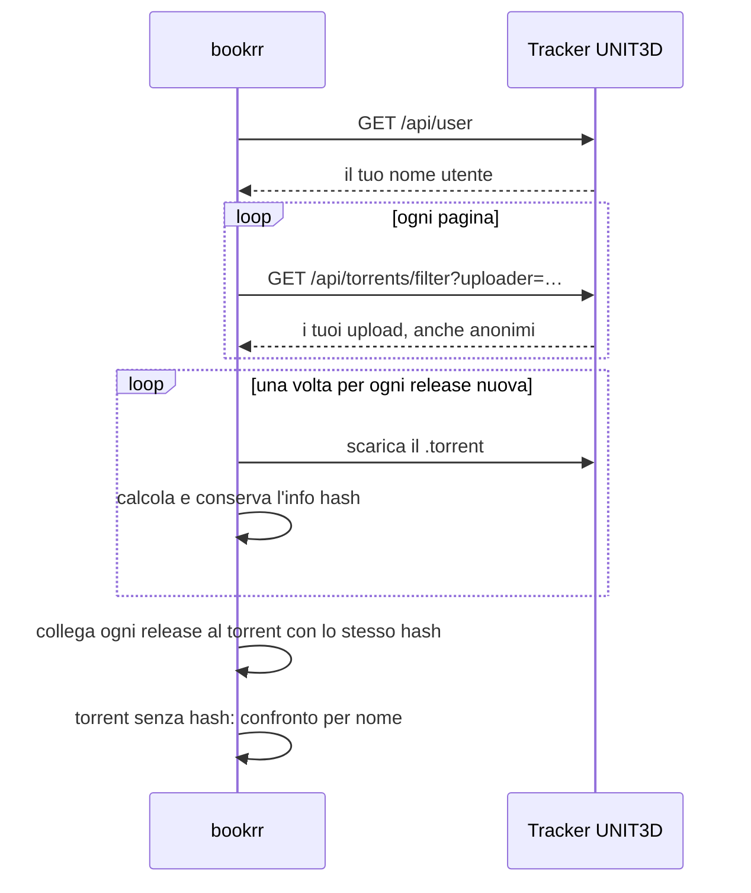
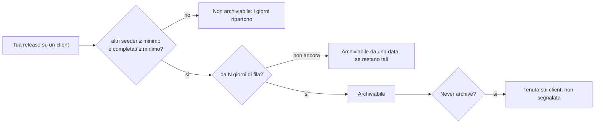

# Tracker

[Documentazione](README.md) · [English](../en/tracker.md)

Con `BOOKRR_UNIT3D_URL` e `BOOKRR_UNIT3D_API_KEY` (o **Settings → Tracker**) bookrr dialoga con un tracker UNIT3D: trova l'hash dei torrent aggiunti senza, tiene lo storico dei tuoi upload e ti dice quali release puoi archiviare.

UNIT3D permette 30 richieste API al minuto, quindi bookrr ne fa al massimo una ogni 2,5 secondi, condivise da tutto ciò che parla con il tracker: un import grande o la prima lettura dello storico finiscono in background mentre continui a usare bookrr.

## Ricerca degli hash

I torrent aggiunti a mano o importati **senza hash** vengono cercati sul tracker in background:

1. bookrr chiama `GET /api/torrents/filter?name=…` e sceglie il torrent con **lo stesso nome** (maiuscole, punti e underscore non contano); se più torrent hanno quel nome usa la dimensione, altrimenti non indovina;
2. se il nome è scritto diversamente (`Harbor.Lights.S02.2160p.ATVP.WEB-DL.DDP5.1.Atmos.DV.H.265-NOVA` contro `Harbor Lights S02 2160p ATVP WEB-DL DD+ 5.1 Atmos DV HEVC-NOVA`) bookrr confronta le caratteristiche della release, scritte in qualunque forma (`DDP5.1` = `DD+ 5.1`, `HDR10` = `HDR10+`, `H.265` = `x265` = `HEVC`): titolo, anno, stagione/episodio, risoluzione, sorgente (REMUX, WEB-DL…), servizio (DSNP, NF…), HDR/DV, codec video e **gruppo** dopo il `-` devono coincidere; l'audio e le lingue del nome del file devono comparire nel titolo del tracker. Ciò che c'è in uno solo dei due nomi non conta, tranne HDR e stagione. Se più torrent corrispondono (o la dimensione, se nota, differisce più del 5%) non indovina;
3. bookrr scarica il file `.torrent` (con il link di download della tua API), ne calcola l'hash e **conserva il file**: lo scarichi dalla scheda del torrent, in *Moved to disk*. Se il download non riesce usa l'hash che alcune versioni di UNIT3D forniscono (`info_hash` o magnet link);
4. il torrent prende l'hash vero, con spostamenti, adozioni e note, e il link alla sua pagina sul tracker. Se bookrr conosce già quell'hash (per esempio perché il torrent è ancora su un client) i due diventano uno solo.

La ricerca parte subito dopo un import e poi ogni ora. I torrent non trovati mostrano il motivo nella loro scheda e vengono cercati di nuovo dopo 24 ore. Dalla scheda puoi:

- **Search the tracker now**: ripete subito la ricerca automatica (`POST /api/torrents/{hash}/lookup-hash`);
- **Pick from the tracker**: elenca i torrent simili, per parole in comune, con dimensione, data e link; puoi cambiare la ricerca (es. solo `Starfall Courier 2019`) e con *Use this* il torrent prende hash e file `.torrent` di quello scelto (`GET /api/torrents/{hash}/tracker-candidates?q=…`, `POST /api/torrents/{hash}/tracker-match` con `{"id": "123"}`).

Il file `.torrent` salvato si scarica anche da `GET /api/torrents/{hash}/torrent-file`. I **tag** dei torrent che non sono su un client si cambiano dalla loro scheda; per quelli su un client fanno fede i tag di qBittorrent.

> UNIT3D aggiunge il tracker al file .torrent, quindi lo stesso contenuto ha un hash diverso su ogni tracker: bookrr usa quello del tracker configurato, lo stesso caricato nel tuo client.

## Storico release

La pagina **Torrents** mostra anche **tutti i torrent che hai caricato** (non solo quelli con il flag Personal Release del tracker, anche gli anonimi): ogni upload sta sulla riga del torrent di bookrr con lo stesso hash, e gli upload di cui bookrr non conosce il torrent hanno una riga tutta loro, con lo stato **Not in bookrr**. Il tracker aggiunge le colonne **Type** (WEB-DL, Remux, Encode… e risoluzione) e **Uploaded**, seeder, leecher e completati, e il link alla pagina sul tracker. Il contatore **Dead** mostra gli upload ancora sul tracker che nessuno ha in seed (rimettili in seed da un client o da un archivio); il filtro della colonna **Status** ha *Not in bookrr* e, sotto *Tracker*, *Uploaded*, *Not uploaded* e *Removed* (non più sul tracker). Con **Columns** scegli quali colonne vedere; il browser ricorda la scelta. I vecchi indirizzi `#releases` e `#dead` funzionano ancora: il primo apre l'elenco filtrato su *Uploaded*, dal più recente.

1. bookrr chiede al tracker il tuo nome utente (`GET /api/user`) e poi i tuoi upload (`GET /api/torrents/filter?uploader=…`, tutte le pagine). Il tracker tiene in cache queste risposte per qualche minuto, condivise tra gli utenti: bookrr aggiunge un parametro con il tuo nome (ignorato dal tracker) per non ricevere la risposta preparata per qualcun altro, che non avrebbe i tuoi upload anonimi;
2. l'API non fornisce l'info hash: bookrr scarica il file `.torrent` di ogni release **una sola volta** (l'hash non cambia), ne calcola l'hash e lo conserva. La prima lettura di molti upload richiede qualche minuto;
3. ogni release è collegata al torrent di bookrr con **lo stesso hash**, che riceve anche il file `.torrent`, il link alla pagina sul tracker e, se mancava, la dimensione. I torrent aggiunti **senza hash** vengono confrontati per nome con le tue release (stesse regole della ricerca degli hash) e, se ne corrisponde una sola, prendono il suo hash;
4. a ogni lettura seeder, leecher e completati vengono aggiornati; le release che non compaiono più tra i tuoi upload restano nello storico, segnate come **rimosse**.

La lettura parte all'avvio, poi ogni `BOOKRR_UNIT3D_RELEASES_INTERVAL` (6 ore) e con **Refresh now**. Gli upload **Not in bookrr** non vengono aggiunti da soli: con **Add to bookrr** (o **Add all to bookrr**, sopra l'elenco) diventano torrent con hash, nome, dimensione, file `.torrent` e flag Personal Release, e dalla loro scheda indichi dove si trovano.

Sopra l'elenco dei torrent un riquadro conta le **Personal Release di bookrr che non risultano tra i tuoi upload** (clicca il titolo per vederle): cancellate o sostituite sul tracker, caricate su un altro tracker o aggiunte senza hash (i torrent su un client che annunciano a un altro dominio non vengono elencati). Se non sono tue release, **togli il flag** a una (icona accanto al nome) o a tutte (**Unflag all**): bookrr toglie il tag `Personal Release` anche dai torrent sui client qBittorrent (solo il tag: torrent e file restano dove sono) e non le segnala più quando spariscono. Se un client non risponde, i suoi torrent restano Personal Release e puoi riprovare.

## Release archiviabili

Una tua release ancora su almeno un client è **archiviabile** quando altri la stanno già seminando: puoi toglierla dai client e archiviarla (o lasciarla agli adottatori). I seeder del tracker comprendono anche te, una volta per ogni client che la semina, quindi:

> **altri seeder** = seeder del tracker − tuoi client in bookrr che la hanno **completa (100%)** e **in seed**

Contano come in seed *Seeding*, *Seeding (stalled)* e *Forced seeding*; un client in pausa, fermato, in coda, in verifica o con la copia incompleta no (non viene annunciato al tracker come seeder). Se il tracker è indietro rispetto ai client gli altri seeder non scendono mai sotto zero.

Una release è archiviabile quando **altri seeder ≥ soglia** e **completati ≥ soglia** da almeno **N giorni consecutivi**. bookrr ricorda da quando le due soglie sono rispettate e azzera la data appena smettono di esserlo: il conteggio dei giorni riparte da capo. La regola viene rivalutata a ogni sincronizzazione dei client, a ogni lettura dello storico release, a ogni rimozione da un client e quando cambi le soglie. Le release già archiviate o adottate (su nessun client) e quelle rimosse dal tracker non vengono valutate.

Le soglie sono in **Settings → Archivable**:

| Impostazione | Default | Significato |
|---|---|---|
| Other seeders (min.) | `1` | seeder diversi dai tuoi client |
| Completed (min.) | `1` | download completati sul tracker |
| Days in a row (min.) | `0` | da quanto devono valere le due soglie; `0` = subito |

Nella pagina **Torrents** la colonna **Archivable** mostra *Yes · for N days* quando è archiviabile, *N/M days* (clessidra) quando le soglie sono rispettate ma non ancora per i giorni della regola, ed è vuota altrimenti; il tooltip riporta seeder totali, tuoi, altri, completati, la regola, la data dei dati del tracker e, per quelli in attesa, il giorno in cui diventano archiviabili. Un clic sul titolo della colonna ordina per i giorni in cui le soglie sono rispettate (prima gli archiviabili da più tempo, poi quelli in attesa, poi gli altri); il suo filtro accetta anche un intervallo di giorni. Il contatore **Archivable** filtra l'elenco e lo ordina per quei giorni. La stessa informazione è nella scheda del torrent (anche quando le soglie sono rispettate ma mancano ancora dei giorni, o perché non è archiviabile). Non ci sono notifiche.

**Never archive**: le release che vuoi tenere sui client si possono escludere. Nella vista **Archivable** (Torrents o Releases) ogni riga ha una casella: spunta quelle che non archivierai mai (o tutte dall'intestazione) e premi **Never archive**; per una sola c'è anche l'interruttore nella scheda del torrent. Non compaiono più tra le archiviabili e mostrano *Never archive*; per ritrovarle usa il link *N never to archive · show* o il filtro della colonna, da cui puoi selezionarle e premere **Flag again when archivable**. bookrr continua a contare i giorni in cui le soglie sono rispettate, quindi se annulli la scelta torna subito archiviabile se lo era già.
